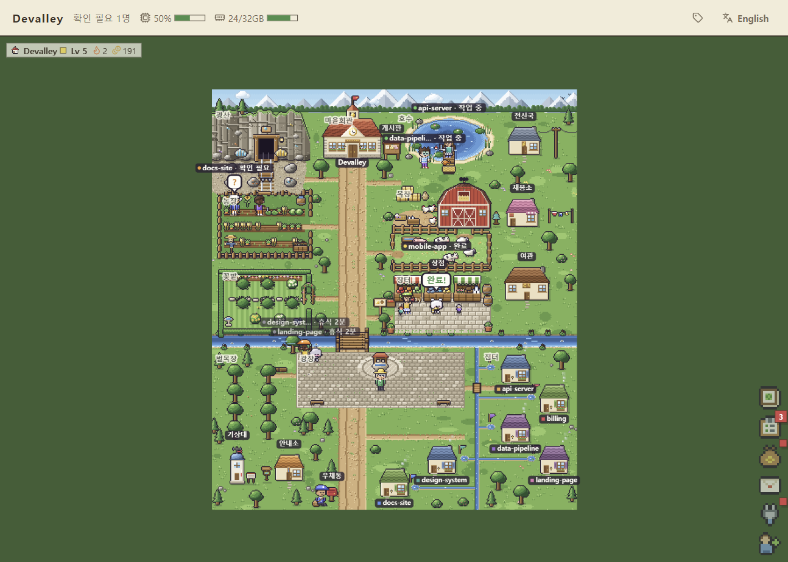
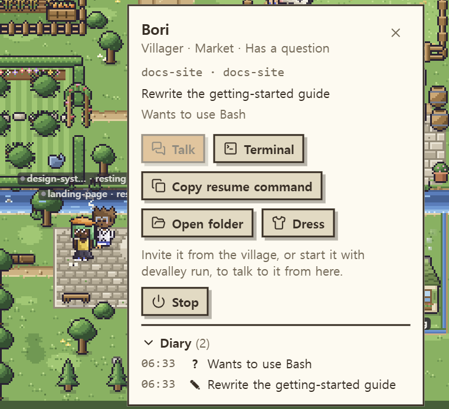
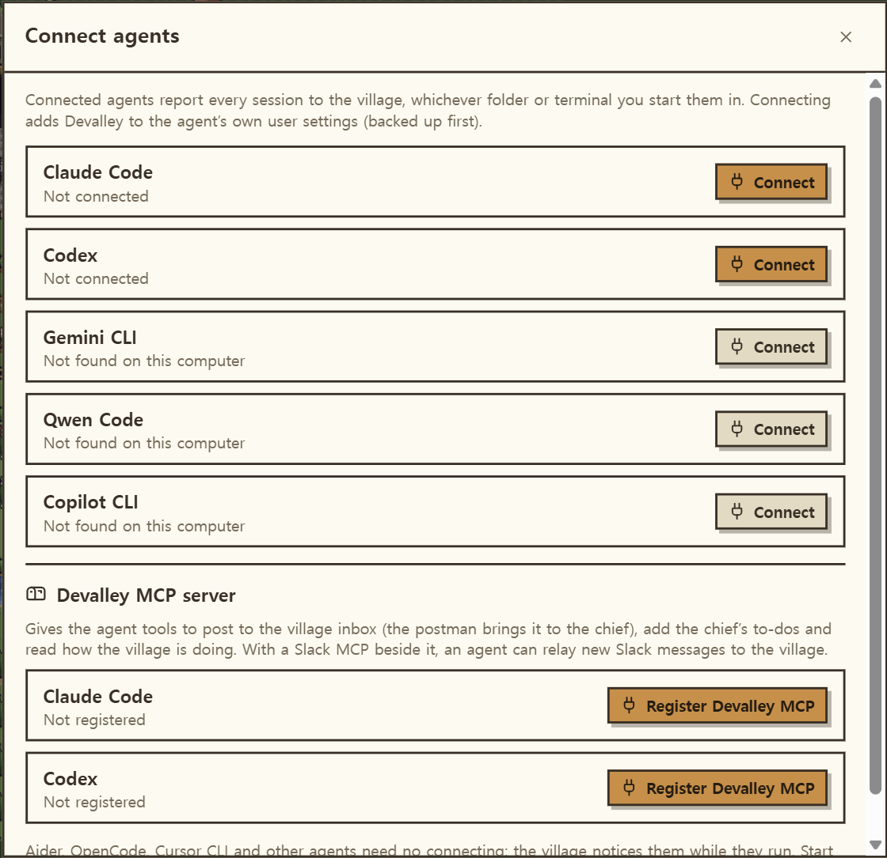
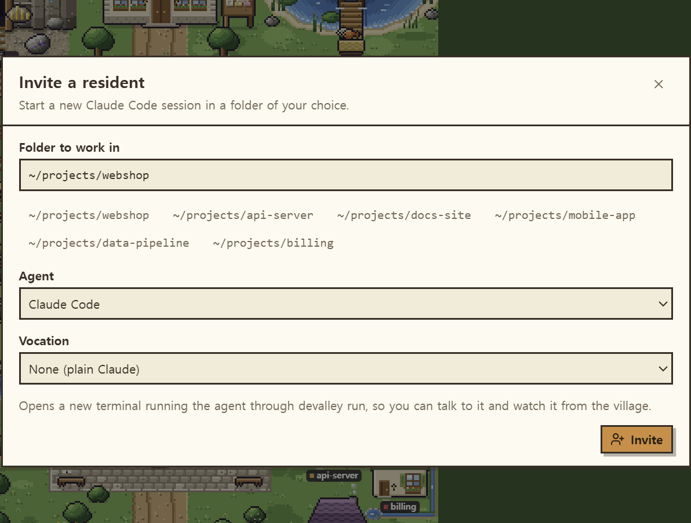
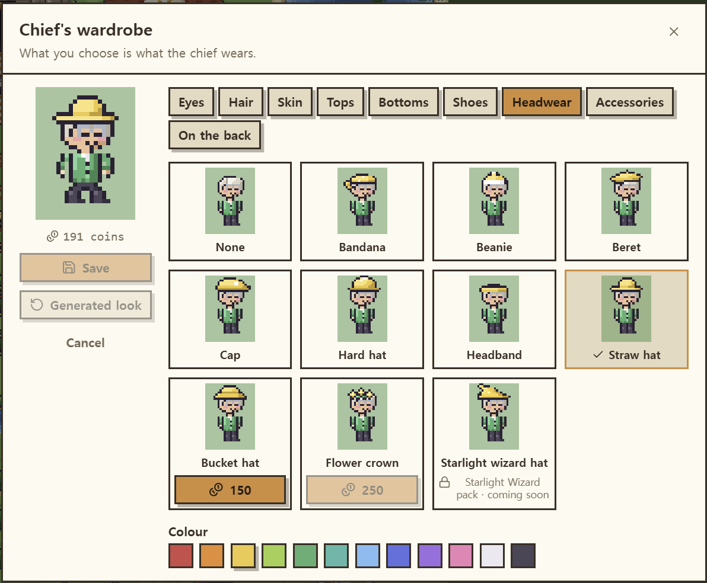
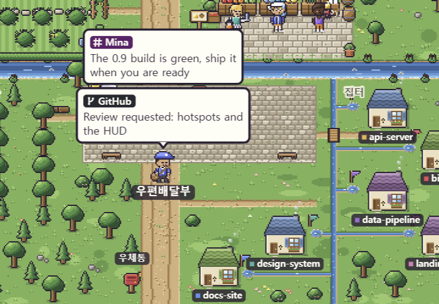
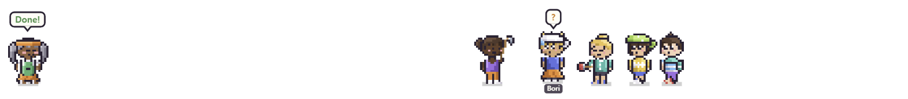
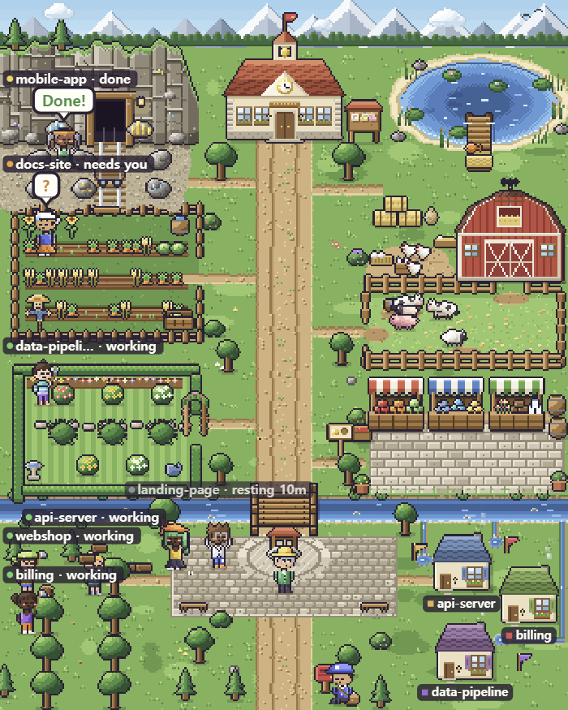

# Devalley

A pixel-art village where every coding-agent session is a resident: Claude Code, Codex, Gemini CLI, Qwen Code, Copilot CLI, Aider, OpenCode and more. It works with them in any folder and any terminal, IDE or ADE: iTerm, Windows Terminal, PowerShell, the VS Code or Cursor terminal, or a tool that launches the agent for you. It also works inside WSL and in a terminal run as administrator.

- **Residents show what their agent is doing.** Working sessions go to work at the farm, mine, lake, ranch, garden, market or lumberyard, and the valley changes as they work: trees fall and grow back, rocks break, fish are landed, crops ripen and are harvested. A question or permission prompt raises a **?** bubble, and a finished turn cheers **Done!**
- **Answer them from the village.** When Claude Code, Codex, Qwen Code, OpenCode or Hermes asks for permission, its resident brings the request to you with a **May I?** bubble: allow or deny it in the resident's conversation, which the bubble and the card open (always allow, and its multiple-choice questions, for Claude Code), or send it back to its terminal. Nothing is allowed without your click.
- **Each agent in each project is one resident,** with the same name and look every session. About one in twelve is born a sprout pup or sprout kitty (a little dog or cat), and about one in four of the rest a small round critter (a cub, bunny, kitty, chick, pup, hamster or frog). Dress them in the wardrobe, and the chief too.
- **Repositories and branches become cottages**: up to six of them, along a creek past the wide plaza, each with its stream and its pennant.
- **Click anything to see what it does.** Point at a building and it says what it is and what a click does. The town hall opens the journal, its notice board your to-dos, the market's stalls the shop and the mailbox the inbox. The telegraph office connects agents, the tailor's dresses the chief, and the visitors' hut by the gate invites a resident. The weather station shows how much of each agent you've used, and the inn is where residents resting for days doze, off the plaza. A cottage shows who lives there, and a workplace who works there now.
- **Name your village.** Its name is on the panel over the map, on the town hall (unless tags are off), in the browser tab and on the app's window.
- **Messages from outside reach the village.** The postman brings Slack, GitHub, Vercel or any other message to the chief as a speech bubble.
- **The chief keeps your to-dos** on the notice board by the town hall.
- **Play as the chief:** walk the chief around the village with the arrow keys, and press Space at any workplace to lend a hand. Every few swings earn a coin or a few, shown over the chief's head, to spend in the shop and the wardrobe.
- **A village journal** fills a square for every day you work, like GitHub's contribution graph. It earns XP, levels and coins, and the coins buy decorations for the valley and clothes for its residents.
- **Free, with an optional account.** Everything above is free and needs no account. On the free plan a small sponsor banner shows over the village for 15 seconds every 30 minutes. A Devalley account adds Pro ([devalley.app/get](https://devalley.app/get)): the official dog and cat residents, the tailor shop, a share link for the grass card, and no banner.



> Status: early development. The village speaks English and Korean; switch in the header.

## Download

Get the installer for your system from **[devalley.app/get](https://devalley.app/get)**, or straight from these links, which always give the latest version:

- **Windows:** the [installer](https://devalley.app/download/latest/win-setup), or the [portable build](https://devalley.app/download/latest/win-portable) to run without installing. The app isn't code-signed yet, so the first launch shows SmartScreen: choose **More info**, then **Run anyway**. The portable build keeps everything the installed one does except what would have to point at its files for later: it doesn't start with Windows, and inviting residents and registering the MCP server work only in the installed build.
- **macOS:** the `.dmg` for [Apple silicon](https://devalley.app/download/latest/mac-arm64) or [Intel](https://devalley.app/download/latest/mac-x64). Drag Devalley to Applications. The first launch is blocked because the app isn't notarized: on macOS Sequoia (15) and later, open it once, then go to **System Settings → Privacy & Security**, scroll to the message about Devalley and choose **Open Anyway**; on earlier versions, right-click the app and choose **Open**.

Installing a new version over an old one closes the running app and its village daemon first (the daemon is asked to save and leave; agents' MCP connections to Devalley stay). The tray menu shows the version you have, and a system notice says once for each new version that it is out. When a newer one is out the installed Windows app downloads it in the background right away and then offers **Install … and restart** with its number (it installs only when you click that, never by itself when you quit; if the installer doesn't start within 20 seconds, the item becomes a browser download). On macOS and with the portable build the tray offers **Get Devalley …** with its number, and your browser downloads the new version's file. On a Mac, quit Devalley, open the disk image and drag Devalley to Applications, replacing the old one; with the portable build, quit Devalley first and then run the new file (while the old one runs, the new one only brings it back). **Check for updates…** says whether you have the latest or the site couldn't be reached. Each release's notes are on the [Releases](https://github.com/dongdongdongdongding/devalley/releases) page.

Devalley lives in the system tray (the menu bar on a Mac): a notice says so the first time. A click on its icon opens the village window, brings it forward when it is behind other windows, or closes it; its menu turns the walking residents on and off; and the installed app starts when you log in unless you turn that off in the tray.

The first time, the village asks to **Connect Claude Code**. Sessions that are already running join on their next prompt, with no restart; new ones move in as soon as you send them a prompt. Devalley's hooks need Claude Code 2.1.139 or later; an older one gets the hooks in the form it understands, and if a connected Claude Code never sends a hook, the connect panel says so and asks you to update it.

Uninstalling Devalley on Windows (the installed build) takes its hooks out of every agent it was connected to and its MCP server out of Claude Code and Codex. On a Mac, where the app goes to the Bin, and with the portable build, where its file is deleted, nothing runs on the way out: choose **Disconnect all agents…** in the tray menu first, which does the same. Your data in `~/.devalley/` stays.

Click a resident to see its task, open its conversation, copy the `claude --resume` command for its session, or open its folder. Click a finished resident to mark its work as seen, or its speech bubble to open its conversation (see **Talk to residents** below).

The panel at the top left shows your village's name, level, streak and coins; click the name to rename the village. The icons at the bottom right of the map open the journal, your to-dos, the shop, the inbox, **Connect agents** and **Invite a resident**, each with a badge when something waits: a dot on the journal until today counts, to-dos left, a dot when something new is within your coins, unread mail (**!** while Slack is in trouble), and on **Connect agents** a dot when an agent on this computer isn't connected or needs reconnecting (**!** when a connected one sends nothing). The buildings do the same: see **Click anything** above.

A cottage's card lists who lives there (click one for their card) and can open the project's folder, invite a resident into it, or bring its one resident's window forward.

A resident's card is for seeing: who it is, its state in one word with how long (**Working**, **Needs you**, **Answer ready**, **Resting**, **Off**, **Error**), its project, and what there is to know now (what you asked it, what it asks, the beginning of its answer). A resident that answered while something it started still runs in the background (a command, a helper it sent off) stays **Working**, with how many such tasks are under way where its answer would be: it will answer again when they are done, and what it said so far is in its conversation, where you can still write to it. A task nothing has been heard of for fifteen minutes no longer counts. Its one orange button opens its conversation, where things are done (talking to it, answering what it asks, stopping a turn, waking it), and is named for the state: **Open conversation**, **Go answer**, **Read the answer**, **Wake in the conversation**. Under it are three tiles (its diary, **Dress**, **Keep on desktop**), and **Stop** is small in the corner. **Folder**, at the end of the project line, shows the session's folder in the file manager; for a session inside WSL that is the folder as Windows names it (a drive's folder for one under `/mnt/c/…`, the distribution's own share for any other). A button whose press takes a moment (the conversation's window coming up, the folder, Stop) turns a small circle until it is done. The card can be moved: drag it by its top row, and double-click that row to put it back; a click on a resident opens its card at the usual place again. The same word and colour are on the tag under a resident's feet on the desktop, which names the state only when the resident needs you, and on its conversation's chip.

Each resident keeps a **diary**, the first tile on its card: what you asked it, what it asked you, and how each turn ended (the first line of its last answer, or the error it stopped on), newest first.



## Other agents

Devalley follows other agent CLIs the same way, from every folder and terminal:

| Agent | How it joins the village | Answer its permission requests in the village |
| --- | --- | --- |
| Claude Code | Connected in **Connect agents** | Yes: allow, deny, always allow, and its multiple-choice questions |
| Codex | Connected the same way, including Codex started from Orca's terminals | Yes: allow or deny |
| Qwen Code | Connected the same way | Yes: allow or deny |
| OpenCode | Connected the same way (a small plugin) | Yes: allow or deny |
| Hermes | Connected the same way (a small plugin) | Yes, once you turn it on in **Connect agents** |
| Copilot CLI | Connected the same way | Yes: allow or deny, for the calls Copilot would ask you about, as far as its flags and saved approvals tell (not inside WSL; some it would allow may still ask) |
| Gemini CLI, Muse Code | Connected the same way | Not from the village: they ask in their own terminal, and the resident shows that they're asking |
| Antigravity, Cursor, Amp | Connected the same way (Amp with a small plugin) | No, and the resident doesn't show it when they wait for your approval: they don't tell their hooks |
| Aider, Cursor CLI, any other | Seen running on your computer; invited, its terminal too | No (an agent that hooks in itself can, below) |

Any other agent that can run a command can move in too: `devalley hook --agent <name>` takes its hook events. Its permission requests can be answered in the village too when its hook runs `devalley hook --agent <name> --wait --decides claude` and reads the answer in Claude Code's format.



Open **Connect agents** from its icon at the bottom right of the map, the telegraph office, the chief's card or the tray menu. Each connection goes into that agent's own user-level settings, with a dated backup next to them (of each file, the first one, made before Devalley ever changed it, and the four newest are kept), so it applies wherever you start it. It never prints anything or gets in the agent's way, except to pass on your answer to a permission request while a village shows it.

Answering in the village: a resident asking for permission shows what it wants to do (the command or the file) on its card, and its bubble and the card's **Go answer** open its conversation, where **Allow**, **Deny**, **Always allow** where the agent offers it, and **Answer in the terminal** are (the last hands the question back to the agent's own prompt and brings its window forward). Claude Code's multiple-choice questions are answered there too. If no village window or page shows the request, or you don't answer within a day, the agent asks in its terminal as before (while the village holds it, the agent's own prompt doesn't show there, and **Answer in the terminal** hands it back sooner); nothing is ever allowed for you. **Answer permission requests in the village**, at the top of **Connect agents**, stops the village holding requests; what the agent then asks in its terminal can still be picked in its conversation when the session is reached through tmux. The resident's diary keeps what you allowed, denied and answered.

On Windows, connecting Claude Code, Codex, Gemini CLI, Qwen Code or Copilot CLI connects it inside WSL too. Every running WSL distribution where that agent has been used gets the same connection, and one you start later is connected within a minute. The other agents aren't connected inside WSL, but they're seen running there, like Aider and Cursor CLI.

Sessions of any agent move in even without a connection, or before their first prompt: Devalley notices them running and tells working from resting on its own. Sessions in the Codex desktop app (and Codex in your IDE) move in too, working while a turn runs and cheering when it ends; their card brings the Codex app forward.

## Invite residents

**Invite a resident** (its icon at the bottom right of the map, the visitors' hut, the chief's card, or the tray menu) opens a new terminal window with a fresh agent session (Claude Code by default, or any other) in the folder you pick, with a vocation for Claude if you choose one. On Windows the window is PowerShell (in Windows Terminal, if that's your default), on a Mac it's Terminal, and on Linux your usual terminal emulator. When the agent exits, the window stays open on a shell in that folder.

On Windows with Claude Code connected inside WSL, an invite of Claude Code opens no terminal at all: it starts inside that WSL distribution with no window. Claude Code runs there the way a woken session does (in tmux, which that distribution needs) and its resident moves in at once; you talk to it, answer what it asks and stop its turns from its conversation. With Claude Code connected in several distributions the dialog asks **where to start**: where it did last time, and the first time where your Claude Code residents run. Other agents still start in a new terminal, as above.



## Talk to residents

You don't have to go to a session's terminal to see what it said or to answer it. Click a resident and choose **Open conversation**, or click its speech bubble: a panel opens with that session's conversation.

- **Read.** The panel shows what you last sent, the session's last answer, and while it works, its progress: what it has said and done so far in this turn, and how long ago it last wrote anything (with a warning after five quiet minutes). What you last sent is folded to two lines, and says **Unfold ▾** when there is more: click it for all of it, and again to fold it (a request that fits in two lines has nothing to press). A button whose press takes a moment (Send, Stop the turn, Wake, Allow and the other answers, a bookmark) turns a small mark until it is done, and takes no second press meanwhile. **Recent answers** opens the answers to your last five requests, each request with what it got (a request of several lines keeps them, folded to two; click it for all of it). A request is often answered more than once, as when the session reports, a task it left running finishes, and it answers again: those answers stay together under the request, the newest shown and the ones before it behind **Earlier answers: 2 ▾**. Over the last answer the same line (**Earlier answers to this request**) shows them in place. Unfold the long ones. While the session asks you something, the answer above the question is an earlier turn's: it is dimmed and says **Previous answer**.
- **Answer.** A request a resident brings to you in the village (the **May I?** bubble, or a question you can answer there) is answered in its conversation: the panel shows what it asks with its buttons (**Allow**, **Deny**, **Always allow**, or the question's choices), and a click on that bubble opens it. Its card only says what is asked and has one button into the conversation. The last answer above the request is from the turn before, so it is shown dimmed as **Earlier answer** while the request is up. Nothing can be sent to that session until you have answered (a resident in a `devalley run` terminal can also be sent back to answer there, and its card still answers). When the session asks in its terminal, its question is in the panel with its options as buttons, and a box for an option that takes your own words. A click picks that option in its terminal. A question's options wait half a second after they appear before they take a click, so a hand on its way to the last question's answer doesn't answer the new one, and while you write in an option's own box the question stays as it is. A question of another agent that the village can't read is said to be asked in its terminal: answer it there (**Terminal** brings it forward); nothing can be sent to that session until then.
- **Send.** Write in the box and press Enter (Shift+Enter breaks the line; Claude Code gets the lines as you wrote them, pasted as one prompt, and any other agent gets them as one line). Drag the top edge of the box to make it taller or lower; a double-click on that edge lets it follow what you write again. A prompt takes 10,000 characters (2,000 for a resident in a `devalley run` terminal): near the limit the box counts, and past it it won't send rather than cut your text. What you wrote and haven't sent stays in that resident's box: when you close the panel, in the app's other windows, and when you start Devalley again. Once a prompt is sent, the box is locked with **Waiting for the answer** until the answer has come or its turn has ended; a prompt that starts no turn gives the box back after a quarter of a minute (one of Claude Code's own commands sooner: see **Commands** below). It is locked too while the session works on a turn started in its terminal, and a panel closed and opened again meanwhile is still locked. While it is, **Stop the turn** interrupts the turn without ending the session. If no word comes back about a send in time, or the app was closed while it was on its way, the panel says so and keeps your words: they may have been sent all the same, so look at the session before sending them again. The resident's card keeps up with all this: it says **Waiting for the answer** too, shows the beginning of the last answer with **Read it all** to open the panel, and, when the session asks something the panel can show, has a line that opens the panel on that question.
- **Send files along.** In the desktop app, a Claude Code resident that runs with no terminal of its own (the ones started and woken from the village) takes files with a prompt: press the paperclip beside **Send**, drop files on the box, or paste (a copied file, or an image from the clipboard). Each shows as a chip over the box with an × to take it out, and stays there with your words if you close the conversation. They go when you send, as the files' paths after your words, a line each (the path the session has for the file: a file under `C:\` goes as `/mnt/c/…` to a session inside WSL): Claude Code takes the path of an image for the image itself, and reads any other file from its path. Ten files at most; a pasted image up to 20 MB (it is kept as a file for a day); a file on a network share or inside another WSL distribution is refused, since the session can't read it, and one that is gone by the time you send is said by name and nothing is sent. With one file and no words the path is typed, not pasted, so even an image goes as its path and Claude Code opens it itself.
- **Commands.** A Claude Code resident that runs in tmux takes its own slash commands from the box: write `/usage`, `/effort`, `/model`, `/plugin`, `/context` or any other as you would in its terminal, and press Enter. A command that puts up a screen of its own (`/usage`, `/help`, the slider of `/effort`, the lists of `/model` and `/plugin`) shows it in the panel as **Command screen**, drawn as its terminal draws it. Work it with the keys under it (↑ ↓ ← →, Tab, Space, ⌫, Enter, Esc), or click the screen and use your keyboard, letters included (`s`, a word to search for); the small box beside the keys types a word into it. Nothing can be sent while such a screen is up; closing it (usually Esc) gives the box back. A command that only prints something (`/effort medium`, `/context`, one Claude Code doesn't know) leaves it as **Command result** over the box, until you dismiss it. A screen taller than the session's terminal (50 lines) is cut at the top, as it is there. After `/clear` Claude Code goes on as a new session: the resident you were talking to leaves, and a new one moves in for the same project.
- **Bookmark.** **Bookmark it** beside an answer keeps that one answer, however many come after it; **🔖 Bookmark** at the top shows it again. There is one bookmark per resident: put on another answer, it moves.
- **Wake.** A resident whose terminal was closed, or whose computer restarted, wears a small sleeping sign and says **Off**, and comes out onto the desktop to be noticed for half a day. After that, and when you ended its session yourself (`/exit`), it says **Off** but rests in the village; **Keep on desktop** on its card brings it out. If you start another session in the same project meanwhile, that one is the project's resident, with its name and outfit, and the one that is off stands beside it; when all of a project's sessions are off, the one you used last is its resident. For Claude Code, **Wake without a window** starts it again on the same conversation with no terminal window, and **Wake and send** does that and sends what you wrote; this takes up to a minute. The panel then shows the `tmux` command that brings the woken session up in a terminal. Other agents get their resume command to copy.

**A−** and **A+** change the panel's text size, **Copy** copies the answer on screen, **Terminal** brings the session's own window forward (a resident that is **Off** has no window, so it has no such button, and neither has one whose session runs inside WSL, which Devalley starts and wakes with no terminal window: such a session is not offered **Answer in the terminal** either), and Esc closes the panel. Drag its title to move it and its edges to resize it; double-click the title to put it back at the right. In the desktop app the panel fills a window of its own, and it is that window you move and resize: wherever the pointer turns into the four-way arrow (the title row and the very top of the window, its buttons aside) a press takes hold of the window, and its left, right and bottom edges and its corners resize it. A resident's card moves the same way: drag it by its top (the name and the room above and beside it, under the same four-way arrow), double-click there to put it back, and it opens at its usual place again when you click a resident. The box you write in grows with what you write, up to two fifths of the screen; where the panel has less room than that, the box scrolls and **Send** stays in reach. An answer counts as seen, and its resident stops cheering, once you open the panel for it or touch the panel, not merely because the answer arrived while the panel was open.

In the desktop app the conversation opens in a window of its own, whether you ask for it from a walking resident or in the small village window, so it never covers the village, and **Walking residents** need not be on for it. It is a window like any other, with a button in the taskbar: it opens where you left it, at the size you left it, shows whichever resident you asked for last, and goes away when you close the panel. A window that has only just been made is given a few seconds to read the village before anything is said. If it doesn't come up, the place you asked from says "The conversation window didn't open. Try again." (among the walking residents, just above what you pressed), and a click on a speech bubble still marks a finished resident seen and brings its terminal forward, as it does where there is no panel. A panel that can't be drawn at all says "Couldn't open the conversation. Try again."

The walking residents' window is always in front, so a resident's card would stay over whatever you go back to. It has a pin beside its close button. **Not pinned**, which is how it starts, the card is put away when you click anywhere else, and comes up again only when you click a resident. **Pinned**, it stays over your other windows. The conversation window has a pin on its title row: **pinned**, which is how it starts, it stays over your other windows; not pinned, it goes behind the window you use like any other, and comes forward when you ask for a conversation again or pick it in the taskbar. The village window has a pin of its own beside its ☰ menu: **pinned**, which is how it starts, it stays over your other windows; not pinned, it goes behind the window you use like any other. The browser page has no pins.

Reading works for every session. Sending, answering and waking reach into the session's terminal, which Devalley can do in two cases:

- **An invited resident**, or one started with `devalley run`: Devalley opened that terminal itself. Its card also has **Message** (a line typed into that terminal as a new prompt, only while the resident is not working, with the terminal's screen under it) and **Watch** (the screen live, read-only). Questions are answered and turns stopped in that terminal.
- **A session running inside tmux** on macOS, Linux or WSL. The panel shows how to set that up once when it is needed: install tmux, and add a small shell function so that `claude` starts inside it. A session inside WSL is written to in its conversation: it has no terminal window, so its card has no **Message**, **Terminal** or resume command. A session started plainly on Windows itself can be read but not sent to; invite it from the village instead.

Devalley never types over something half-typed in the terminal without asking (it shows you the text and offers **Clear and send**, which empties that box first; if a very long draft is not all gone, it shows what is left and you press again), never while a resident waits for your answer on its card, and never while the session is showing a question of its own: the panel shows that question for you to answer first, and what you wrote stays in the box. When two windows send to a session at the same moment, one of them is told the session is still taking the last one in, and keeps its words; send them again a moment later. A woken session that stops at a question before it is ready (whether to trust its folder, for one) shows that question in the panel too: answer it, then wake it again.

Talking needs Node.js 22.13 or newer on your PATH; without it an invited resident still moves in, but can only be watched.

### Vocations

A vocation gives an invited Claude a job. It decides the colour the resident wears and the workplace it keeps to, and its text becomes part of Claude's instructions. Vocations are Markdown files in `~/.devalley/vocations/`; edit the built-in ones or add your own:

```markdown
---
name: Data engineer
look: developer
workplace: mine
---
You build and fix data pipelines. Prefer small, reversible migrations.
```

## Residents

- **One resident per agent and project.** The same agent in the same project is the same resident every time, with the same name and look. A second session of it running at the same time joins as a companion: the family's skin and hair (or kind and fur), an outfit and a name of its own.
- **The chief at work:** the arrow keys walk the chief around the village (the village page, or the village window once it has focus), keeping to paths and fields. At a workplace, each press of Space swings that place's tool, and the place reacts as it does for residents: a tree falls, ore breaks, a fish bites. Now and then a swing earns 1 to 3 coins (1 most often), shown as a coin and the amount over the chief's head, up to 50 coins a day. Click a resident and the chief strolls over again, as before.
- **Sprout pets:** about one resident in twelve is born a sprout pup or sprout kitty, a little dog or cat drawn finer than everyone else. Pets wear their own small accessories rather than people's clothes, and they do all the same work.
- **Critters:** about one in four of the other residents is a small round critter instead of a person: a cub, bunny, kitty, chick, pup, hamster or frog, in a soft fur. Critters wear no hair or clothes, but hats, accessories and things on the back suit them, and they do all the same work.
- **Looks:** residents are dressed from the free parts of the wardrobe (eyes, hair, tops, bottoms, shoes, hats, accessories), with more styles to buy: a hime cut, double braids, a mohawk, a sailor top, a Hawaiian shirt, a puffer, a tutu, a crown, a bear hood, a chef's hat, angel wings, a teddy backpack, bunny slippers and more. A vocation adds its colour: green for planners, orange for developers, teal for researchers, red for reviewers, pink for designers, yellow for marketers; a villager wears a colour of its own.
- **Workplaces:** a working resident goes to a workplace: its vocation's, or, without one, wherever chance sends it for each task (it moves on every few minutes). There it does the place's work with the place's tool, and the place changes as it is worked:
  - **Lumberyard:** each woodcutter fells the tree in front of it; the tree falls, its logs fly onto the woodpile, and a new one grows from the stump, faster while someone tends it.
  - **Mine:** rocks crack and burst, and their ore goes into the minecart, which rolls into the tunnel when it's full.
  - **Lake:** anglers wait for a bite, and the fish they land go into the basket.
  - **Farm:** plots are tilled, sown and grow until they're harvested into the crate.
  - **Garden:** overgrown bushes are trimmed, bloom, and grow shaggy again.
  - **Ranch:** groomed animals come over happy; sheep give wool, cows milk, hens eggs.
  - **Market:** traders call out, townsfolk come by to buy, and the stalls are restocked.

  Now and then the resident takes up a prop for the tool its agent is using instead: typing at a laptop while it edits, a book while it reads or searches files, binoculars for the web, a flag while a subagent works.
- **Breaks:** resting residents sit and doze, stretch, sip from a mug, look around or chat, a while at a time.
- **Faces:** focused while working, worried (with a sweat drop) when asking you something, flustered when blocked, happy when done, sleepy when resting and sulky when forgotten for days. They blink.
- **Wardrobe:** **Dress** on a resident's card opens its wardrobe: pick a body (a person, any critter or a sprout pet), try on any part and colour (a critter's or a pet's colour is its fur), buy the ones that cost coins (coins come from the journal, like the decorations'), and save. The outfit stays with that resident (the agent in that project), and **Generated look** undoes it. The chief's card has a **Dress** button too, and the chief wears its outfit everywhere.
- **Packs:** **Dress the village** (the brush on the village's plate, or the village window's menu) sets the season and the packs. A pack is a folder in your packs folder; **Open the packs folder** there shows where. One **asset pack** redraws the map. **Wardrobe packs** only add things to wear, such as clothes or effects, and up to 16 can be on beside it at once: tick them, save, and their parts are in every resident's wardrobe. Turn one off and its parts leave the wardrobe; an effect a resident already wears stays in its outfit and shows again once the pack is back on.



## Inbox and to-dos

- **Inbox:** messages from outside the village (Slack, GitHub, Vercel, CI, anything) go to the village inbox. The postman waits by the red post box at the gate, whose flag is up while anything is unread. He brings each new message to the chief, holding it up as a speech bubble with its sender all the way there, and for ten seconds once he's arrived: up to four at once, the newest at the bottom, each cut to two lines. The whole message waits in the inbox: open it from its icon at the bottom right of the map, the postman or the post box. Opening a Slack message brings the Slack app forward; any other message opens its link.
- **Slack, as it happens:** connect Slack in the inbox and the messages meant for you arrive the moment they're sent: direct messages and group DMs, mentions of you, replies in threads you started or replied in, and, if you like, every message in channels you follow. Each one shows who sent it and where (DM, #channel, or a thread), and opening it takes you to Slack. You turn each kind on or off there.
- **GitHub and Vercel:** connect them in the inbox with a token and the postman brings what concerns you: a review requested from you, your pull request's CI failing or passing, your pull request merged or closed, your default branch going red and green again, and, if you like, comments on your pull requests. From Vercel, a deployment that is ready or failed (production; previews if you like). The first look after connecting only takes note of what is already there, so it doesn't arrive as mail, and a CI result is only sent once it holds. Opening a letter opens the pull request, the check or the deployment.
- **On the desktop strip** the postman walks in to the chief holding up the same bubbles and, while mail is still unread, waits with an envelope; click him to open the latest message. The inbox's alert setting chooses where he shows up: the village and the strip (the default), the village only, or nowhere (messages are still kept).
- **To-dos:** the notice board by the town hall holds your own to-do list: add, edit, tick off, reorder and delete. The board shows a paper for each open one. Each one you finish is worth 3 XP, up to five a day.
- **For your agents:** Devalley's MCP server gives your agents the village as tools: send a message to the inbox, read the inbox, add and list your to-dos, and see how many residents are working, asking for you, blocked, done or resting. **Connect agents** registers it with Claude Code and Codex for you (settings backed up first). The tools work while Devalley runs; after you quit it, they answer that Devalley is off rather than starting it again.



To connect Slack, open the inbox and follow its three steps: **Create the Devalley app in Slack** (everything is filled in; pick your workspace), install it, and paste the two tokens it gives you. The app is yours, in your workspace; some workspaces need an admin to approve it. To connect GitHub or Vercel, open the inbox, follow the link to make a token on their site (the panel lists the read-only permissions it needs), paste it and check it. The village asks them itself every minute or so (30 seconds to 5 minutes, your choice), so nothing has to reach this computer. Other web services, such as webhooks, can't reach the village, which only listens on this computer; send those through an agent running here with Devalley's MCP server.

## Keep an eye on things

- **Labels:** every resident carries a tag over its head with its project (the repo, plus the branch when it isn't the default one) and what it's doing: working, needs you, done, or resting and for how long. When tags would overlap, the ones that need you win and the rest climb a row or hide until you hover. The tag button in the header switches between all tags, only busy residents' and none. With all tags on, each part of the valley carries its name too: the mine, the lake, the plaza, the cottages and the rest. The signs on the notice board, the mailbox, the stalls and the five houses, and the village's name on the town hall, go only when tags are off.
- **This computer:** the header shows CPU and memory use, updated every two seconds.
- **Agent usage:** a strip along the bottom of the map shows each agent's quota on its own line, by its platform's logo (used share and time until it resets); click it for how much of each plan is left and how many tokens each agent used today and in the last 7 days, by project. Quotas (Claude Code, Codex, Gemini CLI) use the sign-in each CLI already has, so there's nothing to sign in to in Devalley; an expired sign-in shows a **Sign in** button that opens that CLI's login in a terminal. On Windows, if Claude Code is signed in only inside WSL, the sign-in there is used: read only while that distribution is running and one of your Claude Code residents is at work in it, used for that one check and kept nowhere. The usage window says so, and when that sign-in has expired it asks you to open Claude Code in WSL again. Tokens (Claude Code, Codex, Gemini CLI, Copilot CLI) are counted from the session records the agents keep on your computer.
- **Terminal:** a resident's card brings forward the window its agent runs in: the IDE (VS Code, Cursor), the terminal (Windows Terminal, Terminal, iTerm) or the app (Claude, ChatGPT). Linux needs `xdotool`. A resident that is **Off** has no window to bring forward, so its card has no **Terminal** button; nor has a session inside WSL, which Devalley starts and wakes with no window.
- **Zoom:** scroll on the map to zoom in around the cursor, and drag to look around. In the village window the map always fills the window, with no empty edges.
- **Stop:** a resident's card has a **Stop** button that ends its session after you confirm. Devalley only ends a session when it's sure which one it is; when it can't tell (several sessions of the same agent in the same folder), end it in its terminal. A session started in a terminal run as administrator can't be ended from the village; end it in its terminal. A resident whose session is already gone just moves out. So does one that is **Off**, except that a session of it found still running after all is ended too, and so is one the village itself woke without a window. The answers and the bookmark the village kept for a stopped resident go with it, and so does what you had written to it and not sent.
- **When residents leave:** a resident moves out when its session ends, or after 12 hours without a sign of life (3 days while its process still runs). A Claude Code resident you could wake again (see **Wake**) stays instead for 7 days after it was last heard from, **Off** once its session is over, as long as you had asked it something and it ran in a terminal (not a `claude -p` run or an editor's session); then it leaves too. The village keeps at most 5 such residents per project and 50 in all: when there are more, the ones not heard from for longest leave first. Ending a conversation with `/clear`, or switching to another with `/resume`, lets its resident go at once. To send one away sooner, press **Stop** on its card.
- **Long-idle residents:** sessions that have rested for more than 2 days (forgotten terminals, mostly, and residents that have been **Off** that long) are counted in the header. Its list shows each one's folder and command, and stops the ones you pick, or all of them; one that is **Off** moves out, with the answers and the bookmark kept for it (and its session ends too if it still runs after all, or the village woke it), and the window says so before you confirm.

## On your desktop

The app keeps your residents in front of you while you work, in two ways you can switch on and off from its tray icon:

- **Walking residents** stroll along the bottom of your screen, just above the taskbar or dock, and the chief, in its outfit, is always out there with them; click the chief to invite a resident, connect agents or dress it. Press and drag anyone to pick them up: they flail in a fluster until you let go, then drop and carry on from there. Drop the same one again and again and it takes it worse each time: it laughs, startles, wonders, huffs, glares, and at last stamps with rage and runs away from the pointer; left alone it calms down, a step every 15 seconds, and resting the pointer on it for 3 seconds pets it calmer. One that got really cross stays angry for a while and sulks as it calms down, in the village too, and picked up while it is still glaring it flails angrily; dogs, cats and the sprouts have no angry face, so they sulk throughout. The **Walking residents size** slider in the village window's menu (☰) makes them anywhere from half to twice their size. The window is transparent and every click passes through to whatever is underneath, except on a resident. A resident with a question hurries to the middle of the screen and hops with a **?** until you answer, or with **May I?** when you can answer it right there: click it for its card. One that finishes a turn jumps and cheers **Done!**; click it once you've seen the work and it walks off the screen, coming back when it starts its next task (the village window keeps everyone). Residents that go to rest walk off the same way; only those working, asking or just finished walk along the screen, unless you keep one out: **Keep on desktop** on a resident's card (on the strip or in the village) has it stroll there even while it rests, until **Send home**; picking up a resident on its way home and putting it down does the same. Click any other resident for its card, where you can open its conversation or bring its terminal forward, or click its speech bubble to open its conversation right away. A resident whose session went off by itself comes out here under its sleeping sign, drawn a little faded, and looks for you until you wake it: it startles, looks about or tilts its head every so often, and follows your pointer along the screen, stopping just beside it rather than under it, so it stays out of the way of what you click; several of them line up beside the pointer. Move the pointer onto one and it holds still: click it for its card, where you can wake it. A resident whose turn stopped on an error comes after your pointer the same way, with a **!** over its head: click the **!** for its conversation, or the resident for its card. It is out here kept or not, so its card offers no **Keep on desktop** meanwhile. Every resident's name and project, with a dot for what it's doing, stand under its feet.
- **Village window** is the whole village and the agent usage under it, as a small always-on-top window with no frame, sized to fit both exactly. Drag its corner to resize it, and the map zooms to fit. Hover it for its title bar, where you can drag it; its menu (☰) holds long-idle residents, agent usage, tags, **Show usage only** and hiding the window, and the icons over the map open the rest. A window too small for the whole valley shows part of it, starting at the plaza; drag the map to look around. Its pin (beside ☰) keeps it in front of every window; unpinned it is an ordinary window that others may cover. On Windows it is in the taskbar under Devalley's button together with the conversation window, stacked as a browser's windows are (press the button to pick one), and a click on the tray icon brings it forward when it is behind other windows or minimized (a click when it is already in front, or pinned, puts it away).
- **Usage only** (the village window's menu, or the tray) folds the village window down to a small rounded card of frosted glass with each signed-in agent's quota windows, reset times and token counts, right where the map's corner was; drag it anywhere. Its ⌄ folds it further to one line with each agent's tightest window, and **Village ▸** brings the map back. Windows 11 and macOS draw the glass behind it; elsewhere the card is translucent on its own.





The app remembers which windows were on and where the village window was. Its tray menu also invites residents and connects agents (the usage card gives way to the map while the dialog is open, and comes back after), and has a **Start when I log in** switch, which is on by default. **Village window** is one choice there: the map, usage only, or off. On Windows, **Hide walking residents over fullscreen apps** steps the residents out of the way while a game, a video or a presentation has the whole screen (off by default; the app looks at what is in front every two seconds while it is on). On Windows and Linux with more than one monitor, **Walk across monitors** (on by default) lets the residents walk along all of them when they stand side by side at the same scale with their bottoms level; otherwise, or with it off, they keep to the main one (the tray item is greyed out while the monitors don't line up). Dialogs and residents with a question still come to the main monitor. On a Mac the residents keep to the main monitor. While they walk across them all, a fullscreen app you are working in on any monitor hides them; one left playing on another monitor while you work elsewhere does not. **언어 / Language** switches the village and the tray between Korean and English (the system's language until you choose). When the village keeps stopping, a notice says so once, and the tray says so with the last line of its log, offers to start it again and has **Report a problem…** and the log folder right under it. **Quit Devalley** stops the village with the app; your agents' sessions go on as they were, and the next start brings the village back.

**Shortcuts** work from any app: Ctrl+Alt+↑ (⌥⌘↑ on a Mac) goes to the resident that has waited longest for you, opening its card in the village window, and pressed again within 5 seconds goes on to the next one waiting (back to the first after the last); Ctrl+Alt+→ brings that resident's terminal forward (pressed again within 5 seconds, the next one's); Ctrl+Alt+↓ turns the village window on and off; Ctrl+Alt+← opens the inbox; Ctrl+Alt+Home turns the walking residents on and off. While Devalley holds a key, the app that would use it doesn't get it (VS Code and JetBrains IDEs use some of these). The tray's **Shortcuts** menu turns each one on or off and, on Windows, marks a key another program already holds as taken (macOS doesn't say when another app holds a key, so a shortcut that does nothing there is likely taken); **Change shortcuts…** (also in the village window's ☰ menu) picks other keys or moves them all to Ctrl+Alt+F8–F12.

If something goes wrong: **Open the log folder** in the tray opens `~/.devalley/`, where `daemon.log` is the village's log and `desktop.log` the app's; **Info (copy)** copies the version, the daemon's API and the log path for a report; **Report a problem…** opens a new post on the support board when you are signed in to a Devalley account in the app, and the contact page otherwise, with the app's version, the daemon's API and your system filled in (nothing else); or write to support@devalley.app.

The village listens on port 4827. If another program has it, the app offers the next free port when it starts (and the connected agents follow); from a terminal, `devalley config port <n>` does the same (quit the app first: while the app runs the village, the command leaves the port as it is), and `devalley status` shows the village, the daemon's version, each agent's connection and where the logs are. On a Korean system the main commands (`start`, `stop`, `status`, `setup`, `config port`) and `--help` answer in Korean, the rest in English (`DEVALLEY_LANG=en` or `ko` chooses).

## Your data

- **It stays on your computer.** The village listens on this computer only, isn't reachable from the network, and other websites can't post to it.
- **Other accounts on the same computer:** when several OS accounts share this computer, the others can see the village's state from inside it (its sessions, their folders and task lines, and what permission requests ask). Its data folder (`~/.devalley`, yours alone on macOS and Linux, inside your user folder on Windows) and a `devalley run` terminal's screen stay closed to them. We don't recommend Devalley on a computer shared that way.
- **What leaves:** each agent's quota check, sent to that agent's own service with the sign-in it already has; once you connect Slack, the village's own connection to Slack with your app's tokens; once you connect GitHub or Vercel, the village's own questions to them with your token; and, from the desktop app, a look at devalley.app for a newer version when it starts and once a day (nothing about you is sent), so the tray and the village window's menu can offer it. On the free plan, signed in or not, the village fetches the sponsor list and its images from devalley.app once a day and sends back how many times each was shown (only the app version and OS type go with it). Only if you sign in to a Devalley account: a plan check once a day, the village settings sync every 5 minutes while the village runs (which also brings the requests you sent from the site, such as residents to bring in), official pack downloads and their keys, and the grass card's summary while you share it. The [privacy policy](https://devalley.app/legal/privacy) lists every item.
- **What's kept:** your journal, outfits, inbox, to-dos and Slack, GitHub and Vercel tokens live in `~/.devalley/`, the tokens readable only by you; so do your residents' last answers (to their last five requests) and their bookmark, readable only by you, removed at once when you stop or move a resident out in the village, and otherwise, once its session has left the village, 30 days after its last answer (a bookmark, 30 days after it was set); the logs (`daemon.log`, `desktop.log`) are there too, with your home folder written as `~` so your user name isn't in them, and nothing in them is sent anywhere unless you attach them to a report yourself.
- **What changes:** connecting an agent adds Devalley to that agent's user-level settings (inside WSL too, on Windows), with a dated backup of them next to them: the first, made before Devalley ever changed them, and the four newest are kept, older ones of Devalley's are removed, and nothing else of yours is touched.

## History

Devalley started as a fork of [Orca](https://github.com/stablyai/orca), whose village, journal and shop it grew from.
