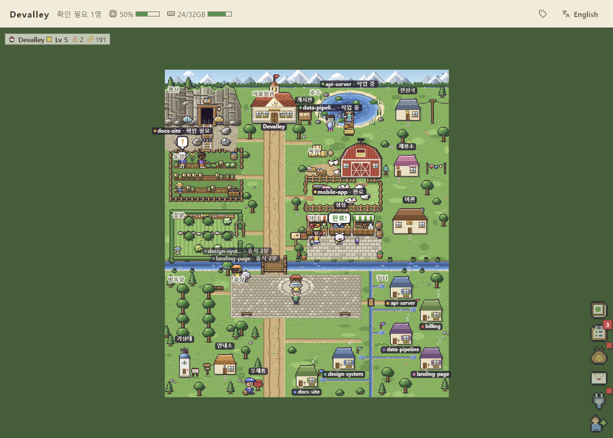
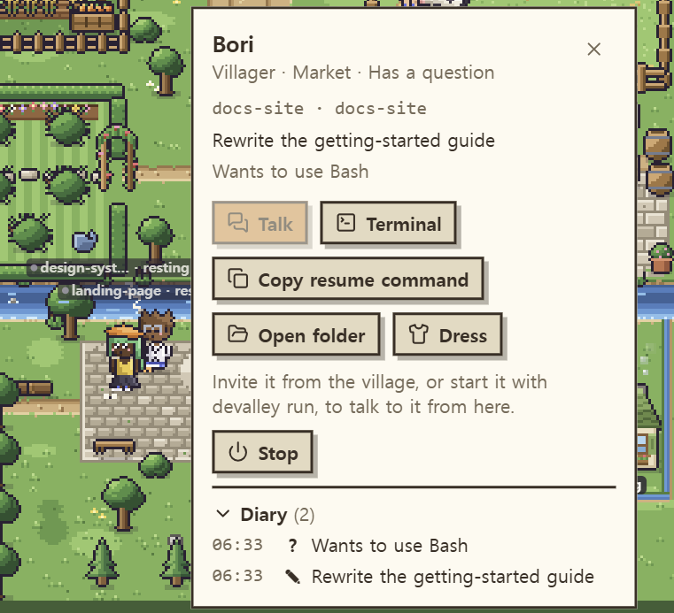
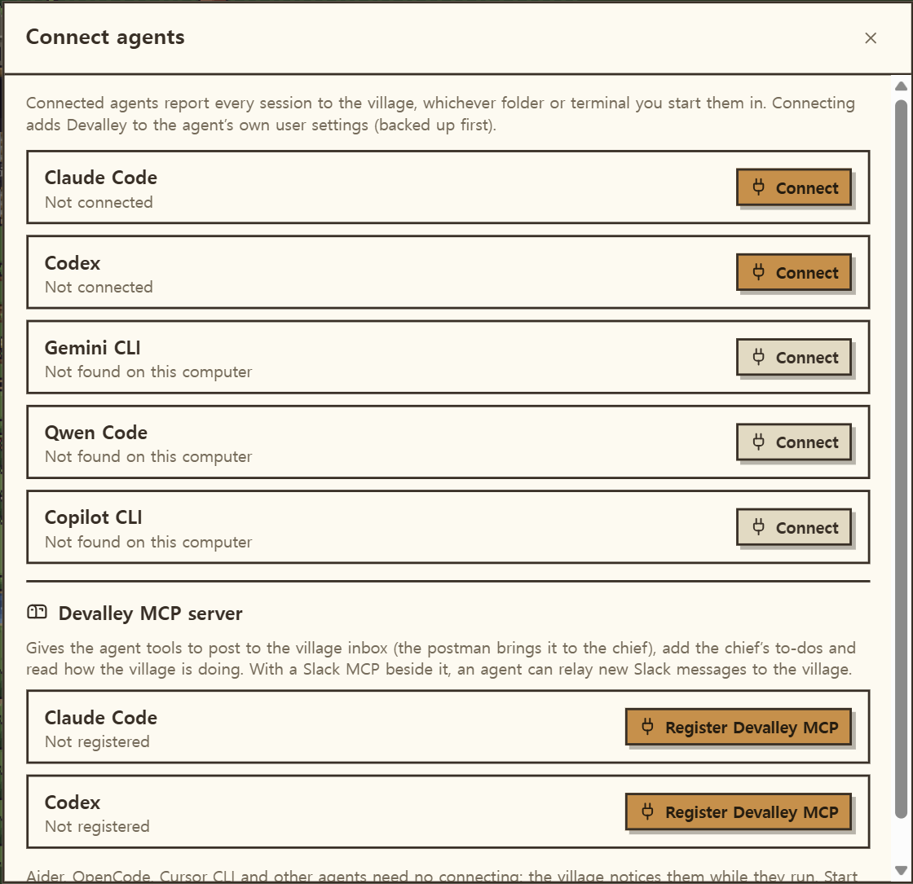
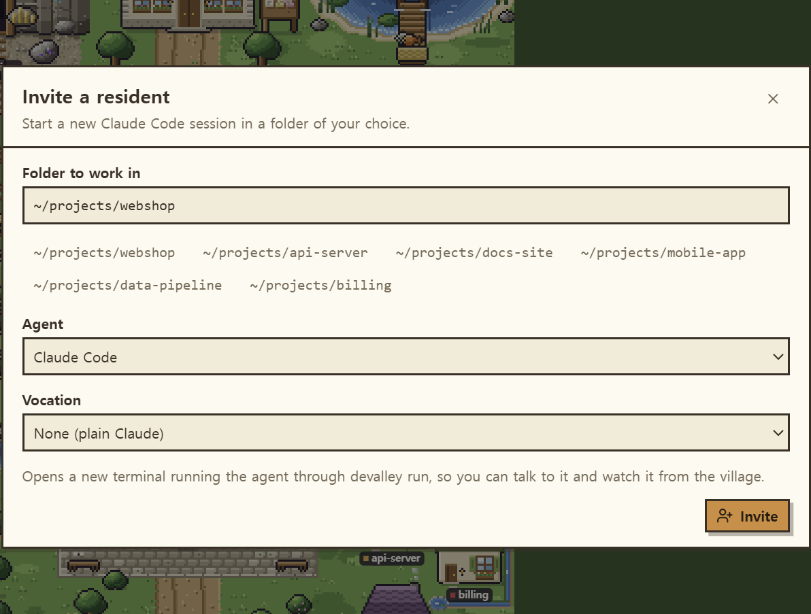
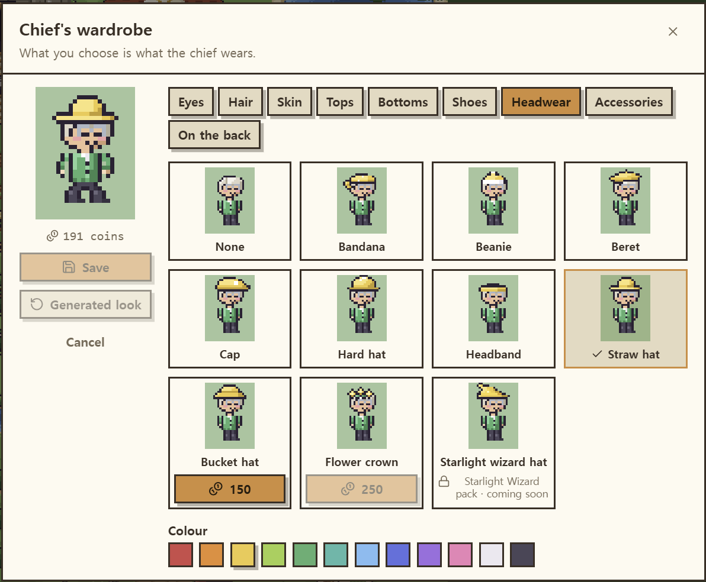
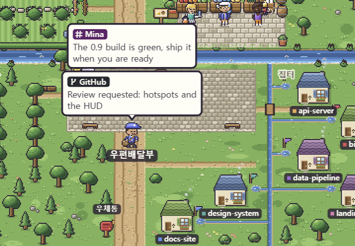
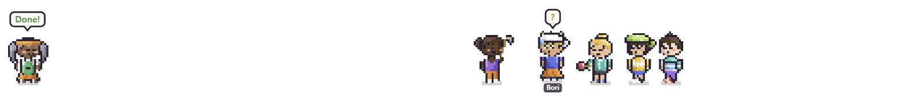
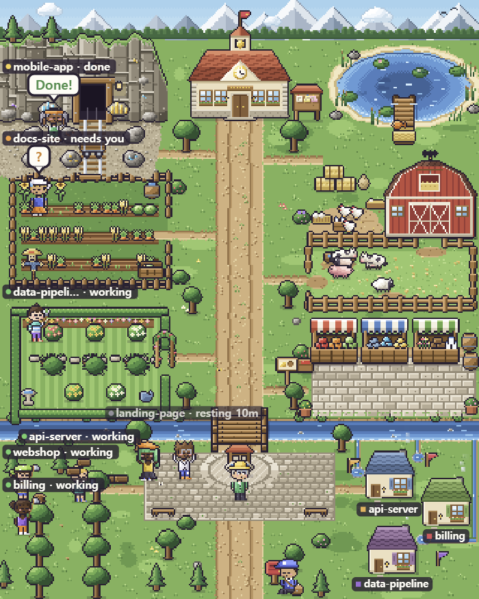

# Devalley

> Free desktop app for Windows and macOS that builds an AI agent village on your computer: every AI coding-agent session you run (Claude Code, Codex, Gemini CLI and others) becomes a resident of a pixel-art village.

A pixel-art village where every coding-agent session is a resident: Claude Code, Codex, Gemini CLI, Qwen Code, Copilot CLI, Aider, OpenCode and more. It works with them in any folder and any terminal, IDE or ADE: iTerm, Windows Terminal, PowerShell, the VS Code or Cursor terminal, or a tool that launches the agent for you. It also works inside WSL and in a terminal run as administrator.

On Windows, you can wake an ended Codex session or move one from your own terminal into Devalley's terminal. The same conversation continues where it stopped.

- **Residents show what their agent is doing.** Working sessions go to work at the farm, mine, lake, ranch, garden, market or lumberyard, and the valley changes as they work: trees fall and grow back, rocks break, fish are landed, crops ripen and are harvested. A question or permission prompt raises a **?** bubble, and a finished turn cheers **Done!**
- **Answer them from the village.** When Claude Code, Codex, Qwen Code, OpenCode or Hermes asks for permission, its resident brings the request to you with a **May I?** bubble: allow or deny it in the resident's conversation, which the bubble and the card open (always allow, and its multiple-choice questions, for Claude Code), or send it back to its terminal. A command longer than its first line comes whole under it, folded when long (**Whole command**), so you can read all of what you allow. Nothing is allowed without your click.
- **Each agent in each project is one resident,** with the same name and look every session. About one in twelve is born a sprout pup or sprout kitty (a little dog or cat), and about one in four of the rest a small round critter (a cub, bunny, kitty, chick, pup, hamster or frog). Dress them in the wardrobe, and the chief too.
- **Codex terminal replies stay with their resident.** For a local interactive `devalley run codex`, supported Codex versions use a separate session server. Explicit remote and noninteractive commands keep their execution mode, and older versions keep their arguments.
- **Your terminal input takes priority.** In newly started village terminals, overlapping sends are refused, and typing directly stops a pending automatic Enter. If a message may have been pasted, check the terminal before sending it again. Existing terminals keep their running version until you start them again.
- **Repositories and branches become cottages**: up to six of them, along a creek past the wide plaza, each with its stream and its pennant.
- **Click anything to see what it does.** Point at a building and it says what it is and what a click does. The town hall opens the journal, its notice board your to-dos, the market's stalls the shop and the mailbox the inbox. The telegraph office connects agents, the tailor's dresses the chief, and the visitors' hut by the gate invites a resident. The weather station shows how much of each agent you've used, and the inn is where residents resting for days doze, off the plaza. A cottage shows who lives there, and a workplace who works there now.
- **Use the conversation window as a terminal.** In the desktop app, **Messages | Terminal** lets you work right in a session's terminal. One the village started or woke opens on **Terminal**, and so does one you started in your own tmux (on a Mac, Linux or inside WSL, shown at its own size) or with `devalley run`; the tab you pick stays for the window: go from resident to resident and the window keeps it, also after the app starts again (a Codex app thread, and a session still to move in, open on **Messages** until you pick their **Terminal**), and switch any time with ⌃` (Ctrl+` on Windows and Linux), even while you type in the terminal. In a window wide enough, **Side by side** shows **Messages** and **Terminal** together for a session with its own terminal: read on the left, type on the right, and drag the line between them (or press ← → on it) to share the width; the window remembers that too. A command's own screen, such as `/model`, stays in **Terminal**: under **Messages** a line takes you there. The first time the window shows a session with a **Terminal** tab it asks **How do you like to work?**: **Like a terminal** keeps that rule, **Like messages** opens residents on **Messages** until you pick a tab; change it later in **Connect agents…** (**The conversation window opens like**). **Terminal** is the session's own terminal, with nothing in between: type straight into it, scroll back, select and copy as in any terminal, and go to **Messages** and back to find it just as you left it. Its keys work as in a Mac terminal: Shift+Enter starts a new line in Claude Code and Codex, ⌥← and ⌥→ jump a word and ⌥⌫ deletes one, ⌘← and ⌘→ go to the start and end of the line and ⌘⌫ deletes back to its start; Ctrl+Z undoes as Ctrl+_ does in Claude Code. Find in it with ⌘F (Ctrl+Shift+F on Windows and Linux), click a file path it shows to open that file beside the conversation, drop files on it to type their paths, right-click for Copy, Paste, Find and Clear scrollback (on a link or a file path it shows, the menu also opens it in your browser, in the Code tab or in Finder or File Explorer, or copies it, and in the desktop app opens an image, PDF or video file with its default app; this works while the agent uses the mouse too, on words you selected or on a link; **Messages** has the same menu for the words you select and the links and paths in it), and jump back to what you sent with ⌘↑ (Ctrl+↑). A drag selects text even while the agent uses the mouse; hold ⌥ (Shift on Windows and Linux) to give the drag to the agent instead. If you read Korean, Japanese or Chinese (the app in Korean, or one of them among your computer's languages), it is set in D2Coding, so Hangul, kana and Han letters fill their two columns with no gap; otherwise it keeps your system's monospace font. It follows the app's light or dark look; a session you started in a terminal app of your own (Orca, Terminal…) shows in that terminal's colours once its agent has asked for them, as Codex and OpenCode do. A line over it appears only when something is wrong, such as the terminal closing. A session you started with `devalley run` in a terminal app of your own (Orca, Terminal…) takes the conversation window's size while you work in the window, and its own terminal's size back as soon as you type there or close the conversation. When a session's screen is bigger than the window, it scrolls inside the window and stays on the prompt; click it to give it the window's size. A session you started without `devalley run` in iTerm2, WezTerm, Terminal, Ghostty, kitty (with its remote control on) or an Orca terminal on a Mac gets a **Terminal** tab that mirrors that window: what it shows, at its own size (WezTerm's and kitty's in colour, the others' as plain text), and the keys you type there go to it; Terminal takes only a line and Enter from Devalley, so a box under the mirror sends one. A line over it says it is a mirror and what it takes. A Claude Code or Codex session you started in a terminal of your own without `devalley run` gets a **Terminal** tab that offers to move it here (from the mirror's line, where the tab is a mirror): press **Move into Devalley's terminal**, and once it is at rest Devalley ends it in that terminal and carries the same conversation on in its own (that terminal goes back to its shell). A session of the Claude app gets the same offer on a Mac: press it, and the session runs here while it stays in the Claude app's list as the same conversation; the app waits for it meanwhile. Press **Give back to the app** over its terminal, and the Claude app opens on it: it carries on in the app, with what you did here (if the app shows **Retry**, press it). If the Claude app has that session open, the tab says so: the app keeps a session it opened until you quit it, so quit and reopen the Claude app, without opening that session, and it can move. A session of the Claude app that is off and open nowhere wakes like any other, too: press **Wake without a window** or send it a message under **Messages**, and it wakes here the same way, still in the Claude app's list. A thread of the Codex app gets a **Terminal** tab too, on a Mac: pick it, and the thread shows there live as a Codex terminal beside the app, which you type into as any. Nothing moves: the thread stays in the Codex app, and what you do in either place shows in the other. Signing in or out and renaming the thread stay the app's, and so do its model, folder and permissions. Stay on that thread there: `/new`, `/resume` or `/fork` typed in it takes that terminal to another thread, while the tab still names this one. If the tab says to restart the Codex app, quit it and open it again once. A thread whose clock settings let only the Codex app on it can't be shown there, and the tab says so. Attachments, `/` commands, **As a team** with the lead's plan, and menus offered as options to pick (the next step of a command such as `/model`) are under **Messages**; in **Terminal** you pick them with the terminal's own keys. A permission the village holds for you shows over the terminal too. **Clear and send** isn't offered there: the terminal's own input box is right in sight. Other terminals keep their existing message controls. If keys you typed may not have reached the session, a line over the terminal says so until your next key: check its screen before you go on. A full confirmation can clear an older matching draft and outdated failure notice; newer edits and uncertain drafts stay.
- **OpenCode's first message.** You can send from its resident before the first conversation starts when its terminal is reachable and its input box is ready. Keep the input box in view; an unfinished draft or a question must be handled first.
- **Name your village.** Its name is on the panel over the map, on the town hall (unless tags are off), in the browser tab and on the app's window.
- **Messages from outside reach the village.** The postman brings Slack, GitHub, Vercel or any other message to the chief as a speech bubble.
- **The chief keeps your to-dos** on the notice board by the town hall.
- **Play as the chief:** walk the chief around the village with the arrow keys, and press Space at any workplace to lend a hand. Every few swings earn a coin or a few, shown over the chief's head, to spend in the shop and the wardrobe.
- **A village journal** fills a square for every day you work, like GitHub's contribution graph. It earns XP, levels and coins, and the coins buy decorations for the valley and clothes for its residents.
- **Free, with an optional account.** Everything above is free and needs no account. On the free plan a small sponsor banner shows over the village for 15 seconds every 30 minutes. A Devalley account adds Pro ([devalley.app/pro](https://devalley.app/pro)): the official dog and cat residents, the tailor shop, a share link for the grass card, and no banner.



> Status: early development. The village speaks English and Korean; switch in the header.

Codex app and IDE helper requests do not become residents. Moving an app thread out leaves it in the app; it returns to the village when you start a new turn there.

## What’s new in 0.21.0

- **Start without knowing terminals.** On the first start the residents panel opens with three steps: pick an agent, install and connect it, and invite your first resident into a folder. On a Mac or Windows PC, Devalley installs the agent you pick in a Terminal or PowerShell window you can watch, and connects it. A Mac without tmux no longer needs to install one.
- **Honest agent rows and one-time connect on a Mac.** Rows say honestly whether an agent is installed, connected or missing (including WSL agents on Windows). On a Mac, agents already on your computer are connected once after the update, and the village tells you what it did with an Undo.
- **Residents know where they live and write to each other.** A resident knows its own name and its neighbours in the project, and can send a letter to another resident by name. Letters stop by themselves after a few exchanges without you, and approvals stay yours.
- **Right-click and drag in Messages and Terminal.** Copy text, open or copy links, and open files from a menu. A plain drag selects text in the Terminal tab (hold ⌥ on Mac, Shift on Windows to pass the drag to the agent). Images, PDFs, video and audio open in their default app.
- **Shell commands from Messages.** A line that starts with `!` runs as a shell command in Claude Code, and its run shows in Messages.
- **Skills in one place.** Each project lists the skills its agents can follow (including WSL residents on Windows). Turn a skill on or off per agent, pin one as a button under the message box, and register your own; the `/` menu hides skills you turned off.
- **Sessions that need a restart say so.** When a running session must restart to pick up a change, the village tells you, and a Claude Code session started by the village restarts on one press, on the same conversation.
- **Lighter on Mac and Windows.** Each session's `devalley run` and `devalley mcp` helper now runs in Rust on both Mac and Windows, using less memory than before. On Windows, compiled helpers also speed up process, folder and console reads.

## Download

Get the installer for your system from **[devalley.app/get](https://devalley.app/get)**, or straight from these links, which always give the latest version:

- **Windows:** the [installer](https://devalley.app/download/latest/win-setup), or the [portable build](https://devalley.app/download/latest/win-portable) to run without installing. The app isn't code-signed yet, so the first launch shows SmartScreen: choose **More info**, then **Run anyway**. The portable build keeps everything the installed one does except what would have to point at its files for later: it doesn't start with Windows, and inviting residents and registering the MCP server work only in the installed build.
- **macOS:** the `.dmg` for [Apple silicon](https://devalley.app/download/latest/mac-arm64) or [Intel](https://devalley.app/download/latest/mac-x64). Drag Devalley to Applications. The app is signed and notarized by Apple, so it opens at once, and what you allow it, like typing into Terminal or iTerm2, stays allowed across updates.

Installing a new version over an old one closes the running app and its village daemon first (the daemon is asked to save and leave; agents' MCP connections to Devalley stay). The tray menu shows the version you have, and a system notice says once for each new version that it is out. When a newer one is out the installed Windows app downloads it in the background right away and then offers **Install … and restart** with its number (it installs only when you click that, never by itself when you quit; if the installer doesn't start within 20 seconds, the item becomes a browser download). On macOS and with the portable build the tray offers **Get Devalley …** with its number, and your browser downloads the new version's file. On a Mac, quit Devalley, open the disk image and drag Devalley to Applications, replacing the old one; with the portable build, quit Devalley first and then run the new file (while the old one runs, the new one only brings it back). **Check for updates…** says whether you have the latest or the site couldn't be reached. **Get preview versions**, under it, offers the next version a few days before everyone gets it (off by default; turning it on checks at once). Each release's notes are on the [Releases](https://github.com/dongdongdongdongding/devalley/releases) page.

Devalley lives in the system tray (the menu bar on a Mac): a notice says so the first time. A click on its icon opens the village window, brings it forward when it is behind other windows, or closes it; its menu turns the walking residents on and off; and the installed app starts when you log in unless you turn that off in the tray.

The first time the app starts after you install it, every agent installed on your computer is connected for you (each agent's settings backed up first); an agent you install later is connected the next time the app starts. An agent you disconnect stays disconnected, and after an update from an older Devalley the agents you hadn't connected stay as they were. Otherwise the village asks to **Connect Claude Code**; where Claude Code isn't installed on the computer yet, it says so instead, and the connect waits until it is. Sessions that are already running join on their next prompt, with no restart; new ones move in as soon as you send them a prompt. Devalley's hooks need Claude Code 2.1.139 or later; an older one gets the hooks in the form it understands, and if a connected Claude Code never sends a hook, the connect panel says so and asks you to update it.

**No agent yet?** On a Mac or a Windows PC, the conversation window's **Getting started** card (and **Connect agents**, for each agent not installed) offers to install one for you: Claude Code first (it needs a Claude Pro, Max, Ultra, Team or Enterprise plan), then the Antigravity CLI, which starts free with a Google account, then Codex, Grok Build and OpenCode. **Install and connect** shows the maker's own install command, and which shell file its installer adds a PATH line to, before anything runs; once you press **Install**, a Terminal window opens showing the same command and waits: press Enter there to start it (close the window to stop; nothing runs before that Enter). Then it installs, starts the agent's sign-in, and the agent is connected as soon as it is installed. Devalley doesn't check the maker's script; its maker's terms apply. If the install doesn't finish, the window is closed, or ten minutes pass after the Enter with no step, the card says so, with **Try again** and the maker's install page. On Windows it is the same with a PowerShell window instead of Terminal, and the card says the installer may add its folder to your user PATH instead of naming a shell file. An agent whose settings are here but whose program Devalley didn't find can be connected with **Connect anyway**, or from a terminal with `devalley setup --agent <name>`. The **Getting started** card also tells you once about the line Devalley added to your shell's file, with **Turn off**.

**Sessions that need a restart.** An agent session that was already running when Devalley connected its agent may not have heard its hooks yet (Claude Code takes them while it runs; the others may need a restart), and one that started before the village's tools were added to its agent runs without them. The village and **Connect agents** say how many residents need a restart, and **One by one** says for each why and exactly what to do: type its quit word in its window (`/exit`, `/quit`) and start it again, with the exact command to copy (`codex resume …`) where Devalley can tell which conversation it is, and "in the same folder" where it can't (it never guesses between two sessions in one folder). A Claude Code session the village started itself has **Restart**, and the line has **Restart all**, which first says how many residents' agents it ends and which: it says first that it ends that resident's agent and starts it again in the same conversation, waits for it to rest (never while it works, asks you something, or has something typed in its box), then restarts it and says how it went. While it waits you can **Cancel** it, and it lets go by itself if you start using that session again. Restarting sessions in your own terminals is coming next.

Uninstalling Devalley on Windows (the installed build) takes its hooks out of every agent it was connected to and its MCP server out of every agent that has it. On a Mac, where the app goes to the Bin, and with the portable build, where its file is deleted, nothing runs on the way out: choose **Disconnect all agents…** in the tray menu first, which does the same, then **Quit and stop the village** (closing Devalley leaves its village running). Your data in `~/.devalley/` stays.

Click a resident to see its task, open its conversation, copy the `claude --resume` command for its session, or open its folder. Click a finished resident to mark its work as seen, or its speech bubble to open its conversation (see **Talk to residents** below).

The panel at the top left shows your village's name, level, streak and coins; click the name to rename the village. The icons at the bottom right of the map open the journal, your to-dos, the shop, the inbox, **Connect agents** and **Invite a resident**, each with a badge when something waits: a dot on the journal until today counts, to-dos left, a dot when something new is within your coins, unread mail (**!** while Slack is in trouble), and on **Connect agents** a dot when an agent on this computer isn't connected or needs reconnecting (**!** when a connected one sends nothing). The buildings do the same: see **Click anything** above.

A cottage's card lists who lives there (click one for their card) and can open the project's folder, invite a resident into it, or bring its one resident's window forward.

The conversation header shows a small **Background N** chip for tasks and helpers at work. Hover to see details the agent has reported. The count stays separate from the resident's state; Claude Code's background-task picker is never presented as a question to answer.

A resident's card is for seeing: who it is, its state with its icon, in one word, with how long (**Working**, **Needs you**, **Answer ready**, **Resting**, **Off**, **Error**; no time for **Off**), its project, and what there is to know now (what you asked it, what it asks, the beginning of its answer). A resident that answered while something it started still runs in the background (a command, a helper it sent off) stays **Working**, with how many such tasks are under way where its answer would be: it will answer again when they are done, and what it said so far is in its conversation, where you can still write to it. A task nothing has been heard of for fifteen minutes no longer counts. Claude Code's watch of an artifact it published (its comments and new versions, kept for as long as the session runs) is no work: the resident rests with its answer, and works again when a comment comes. Its one orange button opens its conversation, where things are done (talking to it, answering what it asks, stopping a turn, waking it), and is named for the state: **Open conversation**, **Go answer**, **Read the answer**, **Wake in the conversation**. Under it are three tiles (its diary, **Dress**, **Keep on desktop**), and **Stop** is small in the corner. **Folder**, at the end of the project line, shows the session's folder in the file manager; for a session inside WSL that is the folder as Windows names it (a drive's folder for one under `/mnt/c/…`, the distribution's own share for any other). A button whose press takes a moment (the conversation's window coming up, the folder, Stop) turns a small circle until it is done. The card can be moved: drag it by its top row, and double-click that row to put it back; a click on a resident opens its card at the usual place again. The same word and colour are on the tag under a resident's feet on the desktop, which names the state only when the resident needs you, and on its conversation's chip. Point at the state for its own line: the tool it is using or the background tasks it left running, what it asks, the time of the message an answer answers, the usage limit that holds a resting one back and when it resets, when an ended session ended, what stopped one on an error. **Why this state?** on the card says, when you press it, what last made it so and how long ago (the agent said it needs your answer, a question is up on its screen, nothing was heard for a while so it was taken to rest), in one line, under the state's own line; then the latest changes it went by, each with its time to the second and the state it led to, and a warning when the turn it answers was begun by the agent itself, with no message from you; for a state that hasn't changed since Devalley was last started it says so, with when it last heard from the session. Where Devalley can't tell just then, it still says the state's own line, which for one that is **Off** is the answer: when its session ended, or was last heard from. The conversation has the same answer in the round **ⓘ** beside its state.

Each resident keeps a **diary**, the first tile on its card: what you asked it, what it asked you, and how each turn ended (the first line of its last answer, or the error it stopped on), newest first.



At a terminal, `devalley setup --help` and `devalley uninstall -h` show their options before changing any settings. Every Devalley command accepts `--help` or `-h`.

## Guides

How-to guides on [devalley.app](https://devalley.app/guides), each checked against the official docs and dated:

- [Check Claude Code and Codex usage limits](https://devalley.app/guides/claude-code-codex-usage)
- [Claude Code notifications](https://devalley.app/guides/claude-code-notifications)
- [Managing multiple Claude Code sessions](https://devalley.app/guides/multiple-claude-code-sessions)
- [Using Claude Code and Codex together](https://devalley.app/guides/claude-code-and-codex-together)
- [Claude Code approvals and permission requests](https://devalley.app/guides/claude-code-approvals)
- [Compare](https://devalley.app/compare): other tools side by side with Devalley

## Other agents

Devalley follows other agent CLIs the same way, from every folder and terminal:

Several Antigravity CLI sessions in one folder keep separate conversations. Until Devalley can
identify a session's current conversation, read its messages in its terminal. The Antigravity
app and IDE provide status only; continue messages, commands and approvals in their own windows.

| Agent                        | How it joins the village                                              | Answer its permission requests in the village                                                                                                                   |
| ---------------------------- | --------------------------------------------------------------------- | --------------------------------------------------------------------------------------------------------------------------------------------------------------- |
| Claude Code                  | Connected in **Connect agents**                                       | Yes: allow, deny, always allow, and its multiple-choice questions                                                                                               |
| Codex                        | Connected the same way, including Codex started from Orca's terminals | Yes: allow or deny                                                                                                                                              |
| Qwen Code                    | Connected the same way                                                | Yes: allow or deny                                                                                                                                              |
| OpenCode                     | Connected the same way (a small plugin)                               | Yes: allow or deny                                                                                                                                              |
| Hermes                       | Connected the same way (a small plugin)                               | Yes, once you turn it on in **Connect agents**                                                                                                                  |
| Copilot CLI                  | Connected the same way                                                | Yes: allow or deny, for the calls Copilot would ask you about, as far as its flags and saved approvals tell (not inside WSL; some it would allow may still ask) |
| Gemini CLI, Muse Code        | Connected the same way                                                | Not from the village: they ask in their own terminal, and the resident shows that they're asking                                                                |
| Antigravity CLI (`agy`)      | Connected the same way                                                | Yes, off its own screen where the village reads its terminal: the resident shows it asking, and the conversation window answers its approvals and questions     |
| Cursor, Amp                  | Connected the same way (Amp with a small plugin)                      | No, and the resident doesn't show it when they wait for your approval: they don't tell their hooks                                                              |
| Aider, Cursor CLI, any other | Seen running on your computer; invited, its terminal too              | No (an agent that hooks in itself can, below)                                                                                                                   |

Any other agent that can run a command can move in too: `devalley hook --agent <name>` takes its hook events. Its permission requests can be answered in the village too when its hook runs `devalley hook --agent <name> --wait --decides claude` and reads the answer in Claude Code's format.



Open **Connect agents** from its icon at the bottom right of the map, the telegraph office, the chief's card or the tray menu. The agents come first, each with whether it is connected (or not installed on this computer yet: an agent that isn't installed can't be connected, so nothing is written to its settings until it is) and, where its usage says it is signed out or its sign-in expired, a sign-in button right in its row; the switches for how they run come after them. Each connection goes into that agent's own user-level settings, with a dated backup next to them (of each file, the first one, made before Devalley ever changed it, and the four newest are kept), so it applies wherever you start it. It never prints anything or gets in the agent's way, except to pass on your answer to a permission request while a village shows it.

**Agents start inside the village's terminal** (macOS and Linux; zsh, bash or fish). So that messages, answers and stop reach an agent in whatever terminal you start it (an editor's too), Devalley adds one line, marked `# Devalley auto-run`, at the end of your shell's file (`~/.zshrc`, for instance) the first time it starts. From then on, typing an agent's command (`claude`, `codex`, `gemini`, `agy`, `grok`, `qwen`, `copilot`, `cursor-agent`, `aider`, `opencode`, `muse`, `amp`, `hermes`) in a newly opened terminal starts it inside a terminal Devalley runs; it looks and works the same. A script, a pipe, a one-shot run and a village that isn't running start the agent as before. When an agent Devalley installed for you has its installer add its own PATH line after Devalley's (Grok Build's and OpenCode's do), Devalley moves its own line back to the end, keeping a dated copy of the file beside it (`.zshrc.devalley-backup-…`); it touches no other line, and never moves it at an ordinary start. The switch **Start agents inside the village's terminal** in **Connect agents** shows the file and the line and turns it off, which takes the line out; turned off, it stays off until you turn it on. **Disconnect all agents…** takes the line out too.

Answering in the village: a resident asking for permission shows what it wants to do (the command or the file) on its card, and its bubble and the card's **Go answer** open its conversation, where **Allow**, **Deny**, **Always allow** where the agent offers it, and **Answer in the terminal** are (the last hands the question back to the agent's own prompt and brings its window forward). Claude Code's multiple-choice questions are answered there too. If no village window or page shows the request (with the walkers strip off and the village window minimised, none does), or you don't answer within a day, the agent asks in its terminal as before (while the village holds it, the agent's own prompt doesn't show there, and **Answer in the terminal** hands it back sooner); nothing is ever allowed for you. **Answer permission requests in the village**, at the top of **Connect agents**, stops the village holding requests; what the agent then asks in its terminal can still be picked in its conversation when the session is reached through tmux. The resident's diary keeps what you allowed, denied and answered.

On Windows, connecting Claude Code, Codex, Gemini CLI, Qwen Code or Copilot CLI connects it inside WSL too. Every running WSL distribution where that agent has been used gets the same connection, and one you start later is connected within a minute. The other agents aren't connected inside WSL, but they're seen running there, like Aider and Cursor CLI. If WSL's C drive stops answering, a line over the village says so and what to try. Once C: is mounted again, the line lists the sessions that were left behind (still working in the old drive, or failing every request with "Unable to read managed policy settings"), and **Revive the sessions** ends each and wakes it again on its conversation, one at work once its turn ends, its team going on, with no WSL restart. A session you started in a terminal of your own is yours to start again, from a new terminal in its folder (`claude --resume`): its old window still works in the old drive. One ended that couldn't be woken again is listed as such; a message to its conversation wakes it. If C: was mounted again as root's, so git refuses its repositories, the line gives the command that mounts it as yours.

Sessions of any agent move in even without a connection, or before their first prompt: Devalley notices them running and tells working from resting on its own. Sessions in the Codex desktop app (and Codex in your IDE) move in too, working while a turn runs and cheering when it ends; their card brings the Codex app forward. Sessions in the Claude app's Code tab move in the same way: on a Mac, a click on their bubble, or **Open the Claude app** on what they ask, opens that very session in the Claude app, and **Stop** in its conversation stops it at its next step, before or after its next tool (on a Mac, with Claude Code connected to Devalley; on Windows, or where the button's tip says to stop it in the Claude app, stop it there). A session you go on with in a terminal while the Claude app still has it open is that terminal's, and **Stop** stops it there as in any terminal. A session you start new in the Claude app is reached the same way, and lives beside the other residents of the folder you pick for it there, moving along when you pick another; until you pick one, it lives in the Claude app's own place (its card says **Claude app · no folder chosen yet**). Their conversation reads as in a terminal, what you typed in the Claude app included, and what you send from the conversation window goes in as your words when the session's turn ends (a session at rest wakes for it and closes a turn first, with one short line). From then its card works on what you sent until it answers, and that short line isn't listed as an answer; slash commands and attachments stay in the Claude app. Ordinary chats and Cowork sessions of the Claude app can't be reached from Devalley: they don't move in, and nothing is sent to them from here.

**Apps read through their windows** (macOS): the Claude app's ordinary chat, the ChatGPT app's ordinary chat and the Antigravity IDE's agent panel open no other way in, so Devalley can read the conversation each shows through its window, once you press **Connect through the window** for that app under **Read apps through their windows** in **Connect agents** (macOS asks for Accessibility then, once). Each chat it shows becomes a resident with its messages in the conversation window, marked as read through the app's window. For the Claude app's chat you can also turn on **Bring the app forward to send**: then what you send or stop from the conversation window brings the Claude app forward for a moment to type it in and puts back the app you were in; nothing is sent while the app shows another conversation, and a message the app didn't show back is never sent twice. The other two are only read: send and stop in the app. While the app is behind other windows it doesn't draw, so the resident shows the chat as the app last showed it, and says since when. The ChatGPT app gives its chats no id, so a ChatGPT chat is known by its title: two chats of one title show as one. The Antigravity IDE's panel shows no conversation to read yet.

## Invite residents

**Invite a resident** (its icon at the bottom right of the map, the visitors' hut, the chief's card, or the tray menu) opens a new terminal window with a fresh agent session (Claude Code by default, or any other) in the folder you pick, with a vocation for Claude if you choose one. On Windows the window is PowerShell (in Windows Terminal, if that's your default), on a Mac it's Terminal, and on Linux your usual terminal emulator. When the agent exits, the window stays open on a shell in that folder.

On a Mac (and Linux), an invite of Claude Code opens no terminal either: it starts on this computer with no window, inside tmux (the Mac app carries its own, used where the Mac has none), and its resident moves in at once, to be talked to from its conversation. On Linux the invite can also open a new terminal instead (**Where to start**), for a computer whose tmux isn't installed yet. Other agents' invites open a terminal as before.

On Windows with Claude Code connected inside WSL, an invite of Claude Code opens no terminal at all: it starts inside that WSL distribution with no window. Claude Code runs there the way a woken session does (in tmux, which that distribution needs) and its resident moves in at once; you talk to it, answer what it asks and stop its turns from its conversation. This holds as well in the moments the village hasn't reconnected to WSL yet (after WSL starts again): where your Claude Code residents run inside WSL, or the last invite started there, an invite of Claude Code never opens a window. With Claude Code connected in several distributions the dialog asks **where to start**: where it did last time, and the first time where your Claude Code residents run. Other agents still start in a new terminal, as above.



## Talk to residents

You don't have to go to a session's terminal to see what it said or to answer it. Click a resident and choose **Open conversation**, or click its speech bubble: a panel opens with that session's conversation.

- **Read.** The talk reads as turns. The turn it stands on is a card: what you last sent and when (**You said · 10:31**), its state at the card's top right (**Waiting for the answer** the moment after you send, **Working**, or **Done · 40s** once it has answered, with how long it took), then while it works its progress, and once it is done its answer. What you sent is folded to two lines, and says **Unfold ▾** when there is more: click it for all of it, and again to fold it (a request that fits in two lines has nothing to press). The turns before it are a line each above the card (when it was asked, its first words, and **Done · 6m**): click one for the request whole and what it was answered, and again to fold it. The last two show; older ones wait behind **Earlier turns 7**, which reads them again as it opens. While a new turn works, the answer before it folds into such a line too. The progress counts what the turn did by kind (**Files read 7**, **Files changed 3**, **Shell 4**, **Searches**, **Subagents** with how many are at work, **Other**), each a row with the first names that opens to every step; what the session said last stays whole under the rows (what it said before behind **Said before**), its last step is named at the foot, and it says how long ago it last wrote anything (with a warning after five quiet minutes). **Detail** shows every step in order instead, **Zen** one line; the choice is kept in this window's browser. Where the session's code can be opened, **See this turn's changes ›** opens it on its **Review**: beside the files changed while the turn works, and beside the answer's **Copy** once it is done. Scrolled up while it works, you are left where you read, and **New ↓ 3** at the foot takes you down to what came. A button whose press takes a moment (Send, Stop the turn, Wake, Allow and the other answers, a bookmark) turns a small mark until it is done, and takes no second press meanwhile. A request is often answered more than once, as when the session reports, a task it left running finishes, and it answers again: those answers stay together in its turn. The last answer is all of them as one answer: one heading with the time of its first and last piece, the pieces in the order they came with a thin line between them (the latest six; any older behind **Earlier answers to this request** at its top), so a short last word never hides the answer before it that said it all. **Copy** in its heading copies all of it. Unfold the long ones. While the session asks you something, the answer above the question is an earlier turn's: it is dimmed and says **Previous answer**.
- **Answer.** A request a resident brings to you in the village (the **May I?** bubble, or a question you can answer there) is answered in its conversation: the panel shows what it asks with its buttons (**Allow**, **Deny**, **Always allow**, or the question's choices), and a click on that bubble opens it. Its card only says what is asked and has one button into the conversation. The last answer above the request is from the turn before, so it is shown dimmed as **Previous answer** while the request is up. Nothing can be sent to that session until you have answered (a resident in a `devalley run` terminal can also be sent back to answer there, and its card still answers). When the session asks in its terminal, its question is in the panel with its options as buttons, and a box for an option that takes your own words. A click picks that option in its terminal. A question's options wait half a second after they appear before they take a click, so a hand on its way to the last question's answer doesn't answer the new one, and while you write in an option's own box the question stays as it is. A question of another agent that the village can't read is said to be asked in its terminal: answer it there (**Terminal** brings it forward); nothing can be sent to that session until then.
- **Send.** Write in the box and press Enter (Shift+Enter breaks the line; Claude Code gets the lines as you wrote them, pasted as one prompt, and any other agent gets them as one line). Drag the top edge of the box to make it taller or lower; a double-click on that edge lets it follow what you write again. A prompt takes 10,000 characters (2,000 for a resident in a `devalley run` terminal): near the limit the box counts, and past it it won't send rather than cut your text. What you wrote and haven't sent stays in that resident's box: when you close the panel, in the app's other windows, and when you start Devalley again. Once a prompt is sent, the box is locked with **Waiting for the answer** until the answer has come or its turn has ended; a prompt that starts no turn gives the box back after a quarter of a minute (one of Claude Code's own commands sooner: see **Commands** below). A prompt you send to Claude Code while a turn runs waits for that turn to end, unless the turn takes it in on the way; when it waits, it runs as the next turn, the resident stays at work and the box stays locked until that turn ends too, and each answer stays with the request it answered. It is locked too while the session works on a turn started in its terminal, and a panel closed and opened again meanwhile is still locked. While it is, **Stop the turn** interrupts the turn without ending the session. When a Claude Code session's hooks don't reach the village (inside WSL that lost its Windows drive, for one), the village follows the turn in the session's transcript instead: a few seconds after you send, it shows the session at work on your prompt, and its answer when the turn ends, with a note that the session is followed from its records. If no word comes back about a send in time, or the app was closed while it was on its way, the panel says so and keeps your words: they may have been sent all the same, so look at the session before sending them again. The resident's card keeps up with all this: it says **Waiting for the answer** too, shows the beginning of the last answer with **Read it all** to open the panel, and, when the session asks something the panel can show, has a line that opens the panel on that question.
- **Send files along.** In the desktop app, a Claude Code resident that runs with no terminal of its own (the ones started and woken from the village) takes files with a prompt: press the paperclip beside **Send**, drop files on the box, or paste (a copied file, or an image from the clipboard). Each shows as a chip over the box with an × to take it out, and stays there with your words if you close the conversation. They go when you send, as the files' paths after your words, a line each (the path the session has for the file: a file under `C:\` goes as `/mnt/c/…` to a session inside WSL): Claude Code takes the path of an image for the image itself, and reads any other file from its path. Ten files at most; a pasted image up to 20 MB (it is kept as a file for a day); a file on a network share or inside another WSL distribution is refused, since the session can't read it, and one that is gone by the time you send is said by name and nothing is sent. With one file and no words the path is typed, not pasted, so even an image goes as its path and Claude Code opens it itself. A session in the Claude app takes no files from here: attach them in the Claude app.
- **As a team.** Press **As a team** beside **Send** and a Claude Code resident (one started in a terminal, inside WSL or on a Mac or Linux) leads from then on, as an orchestrator's coordinator: it plans the request and gives out the work, and edits no files itself (to have a resident do the work itself, send without **As a team**; for a lead, start a resident of its own, so what it keeps in mind is the team's). A team pays for big work in parts that build on each other (a plan, then the server's API, then its screen), for several jobs that don't touch each other, or for research or a review the work then builds on; work one session would do (a small fix, work on the same files, a cause still to be found) goes to one member, a plan of one task (the line under the box says so while **As a team** is on). Its plan comes as a card: **Start N team members?**, with why a team pays, the steps and who does what in each (at most 5 steps and 4 members a step, and as many members in all as you let it have, so a team can be as big as the sessions you keep going; a plan past those steps is not cut but said under the lead's answer, and the lead asked to write it again within them; a member the plan gives work in several steps is one member, started once, its later tasks typed into the same session); a lead that says one session would do without naming anyone is asked at once, by Devalley, to name the member, and its plan of one task comes as that card, so you decide once, seeing who. While a plan's card waits for you, its lead says **Team plan** where it would say **Answer ready**: on its row and its face in the list, at the top of its conversation and in the chief's notebook, and a line over the box says the plan is above, with **See the plan** to go to its card; it says its own state again once you start the team, give it the work or press **Not now**, or the lead answers again. A lead whose answer already gives what you asked, with nothing to give out, says so, and its answer shows as words alone, with no card; a plan Devalley couldn't read is said under the answer (nothing was given out), and the lead is asked once to write it again (**Ask the lead to write it again** for an older answer). A plan stays the request's even where the lead answers once more after it, as when a hook sends its turn on. The team stays, as a task force: its members are kept between the lead's requests, each with what it learnt in its session, and a request sent as a team lists them to the lead, which gives the next work to the ones it needs by name (the rest rest) and adds a member only for a part of the project none looks after (roles are named by the part they look after, such as the server or the screens, not by one request's feature); a plan whose every task goes to a member the team already has starts no new session, so it is given at once, with no question, and a line under the lead's answer says to whom (or that they start once the current work is done, or why it couldn't be given), unless a task goes to a member whose part is another: then it comes as a card, which says under the step whose part that member's is, so you give the task to another on its chip or as it is; where a plan adds a member, the question says who each task goes to and how many new members join (**Give it to the team**); allowed while the team is on a request (**Start when the current work is done**), the next waits for that one, and the team's badge says a request is waiting. A Claude Code session already open in the lead's folder (started in a terminal, and in no team) can be brought in too: a request sent as a team names the latest six to the lead (the line under the box says how many), which may give one a task where its conversation already knows that part. On the card, who takes each task is a chip beside its role: press it for the list of who may take it, the team's members first, then this folder's sessions (where each stands, and its last task), then a new member. A task in a member's part goes to that member from the start, even one at work (the chip says it takes it once its work now is done). A member or a session goes on at once, and so does a new member where the lead had one; a new member in place of a member or a session (one session more than the lead planned) is asked of the lead first, as one line in its conversation, the start waiting meanwhile (**Waiting for the lead**; **Take the question back** returns the task to whom it had), and the card comes back under the lead's answer: a new member is fine, or another would do it better, put on the chip with **To _name_ (as the lead says)** and **A new member even so**. **Sessions to bring in** says where each session a task goes to stands; one gone to another team is greyed, and a new member takes its task. A plan that brings a session in is always asked about. One brought in keeps its conversation and its box: its task goes in only once it rests with its box empty, until then its badge and the lead's team line say what it waits for (a draft in its box, its own work, a question); one that is off is woken for it, and after 10 minutes of waiting the team stops and says so. A member the team started waits the same way while a turn of its own runs or a question of its waits, shown the same; its box is the team's, so a draft left there is cleared as before. A lead with a team does no work itself, as an orchestrator's coordinator: work one session would do goes to one member, and at the end, a check that fails in a member's folder goes back to that member as a fix. A member of a team makes no team of its own (its **As a team** is greyed). **As a team** stays as you leave it for each resident: on, everything you write it goes to its team as a request, by **Send** and by Enter alike; off, you talk with it as with any resident (a question, a talk about the plan). What you sent shows as you wrote it, tagged **As a team**: the few lines Devalley adds for the lead are left out of the screen; at a member, what it was sent is one line, its team's work and step, the task itself a press away; the lead's report reads **Team report: _title_**. The lead writes the steps, roles and tasks in your language. A member has no **As a team** of its own, and its badge only says where it stands: the team is stopped, carried on and disbanded at its lead. Allow a new team and Devalley starts the first step's members, each a new resident with no window, in the project's own folder on the branch it is on (no worktree and no new branch, as an orchestrator's workers: settings that live only in the folder, a build, a port or a local database stay as they are; a member works apart in a worktree of its own only where you ask the lead for it), and types each its task. Steps run in order, each starting from what the ones before left; two members share a step only where their parts are independent and change different files. A member checks its part with the project's quick checks and leaves its changes uncommitted; once every member of a step has answered, the next step's start, told what the step before did; when the last step is done, the lead is told what came of it all, and runs the project's full check once and commits. The team's work is read at its lead: a member's answer to its team's task is not announced on its own, and under the lead's answer to its team's report, buttons, one for each member that took part (**See _role_'s work ›**), open that member's conversation; a member whose session has ended has none. Each step's answer is the one given for it, a member in two steps answering each. The members a request leaves out fold into one line under its order (**Resting members: N ›**). Each member's questions and permissions come to you as any resident's do. At the lead, **Manage team ›** on the team's badge over its talk opens, first, the one thing its state calls for: **Stop the team** while it runs, which stops the members working where they are and starts no one after (a request waiting for it is dropped); a team also stops itself before its next step once your usage is past 90 %. A stopped team says why, and its **Carry on** goes on from the step it stopped at (the members who were working are asked to go on); a team resting between requests shows nothing. Beside it, **Disband**, asking first, stops the team, ends its members' sessions and takes it off the list: what they changed stays, a session brought in stays on, out of the team only, and the lead goes back to working on its own. **Take out of the team** beside a resting member lets one go: one brought in at once, one the team started asked first, as its session ends. (With an older Devalley running, **Remove** takes a stopped or finished team off the list instead, its residents left as they are.) A team member's conversation and card show where it stands: the team's steps as one line of stations, its own face ringed, and who starts once it is done; **Manage team ›** shows every step and member. In the village window, the project buttons under the top row (shown as you point at the window, the ones waiting on you always) each open that project in the window in place of the map: the team working on it as its line and its order (with **Stop the team**, **Carry on** and **Disband**), then its other sessions, or with no team, its sessions; **‹ Village** at its top goes back to the map, as you left it. Nothing is pushed for you.
- **Buttons under the box.** Under the message box are buttons that send a prompt to that resident when you press them: three to start with (**Explain this project**, **Review my changes**, **What next**, which only ask to be told something), and your own: press **+**, name what is written in the box, and **Save the button**. A skill pinned there is sent the way its agent starts a skill (`/name` for Claude Code, Grok Build, the Antigravity CLI, Copilot CLI, Cursor and Qwen Code, `$name` for Codex, `@name` for OpenCode), with what you have written in the box after it. For an agent without that skill the button puts the skill's instructions in the box, so you read them and press **Send** yourself, and if they changed since you pinned it, it says **Changed · check again** first. A skill the agent has turned off, or one named like the agent's own command, can't be pressed, and says why. The buttons are kept on this computer, for each project.
- **Commands.** A Claude Code resident that runs in tmux takes its own slash commands from the box: write `/usage`, `/effort`, `/model`, `/plugin`, `/context` or any other as you would in its terminal, and press Enter. As you type `/` and the first letters, the commands that match are listed over the box, Claude Code's own and that session's own commands and skills: ↑ ↓ to choose, Tab to put one in the box, Esc to close the list. A session of the Codex app or the Claude app has no such list: what you send there goes as words, so run its commands in the app. A command that puts up a screen of its own (`/usage`, `/help`, the slider of `/effort`, the lists of `/model` and `/plugin`) shows it in the panel as **Command screen**, drawn as its terminal draws it. It takes at most half the panel at first, so the answers above stay in sight; drag its top edge to make it taller or shorter (double-click the edge: back to half), and the panel keeps that height next time. Work it with the keys under it (↑ ↓ ← →, Tab, Space, ⌫, Enter, Esc), or click the screen and use your keyboard, letters included (`s`, a word to search for); the small box beside the keys types a word into it. Nothing can be sent while such a screen is up; closing it (usually Esc) gives the box back. A command that only prints something (`/effort medium`, `/context`, one Claude Code doesn't know) leaves it as **Command result** over the box, until you dismiss it. A screen taller than the session's terminal (50 lines) is cut at the top, as it is there. After `/clear` Claude Code goes on as a new session: the resident you were talking to leaves, and a new one moves in for the same project.
- **Bookmarks.** **Bookmark it** beside an answer keeps that answer, however many come after it, up to five per resident; **Bookmarks** at the top lists them, oldest first, each a line you click to read it whole, with its own **Remove bookmark**. Pressed beside an answer already kept, the link takes it off. When there are five, the panel says so and keeps none in place of another: take one off first.
- **Give a moved session back.** A native Claude Code or Codex session moved into the village can be returned to a new terminal with the same conversation and account. **Give back to Orca** opens it in the original Orca workspace when that host was known; otherwise **Give back to a terminal** opens the platform terminal. Devalley first sends its own exit command and waits for its village process to leave. If a handoff is interrupted, the page says so: check both terminals before continuing, because Devalley never repeats an uncertain exit or terminal launch.

- **Wake.** A resident whose terminal was closed, or whose computer restarted, sits down and falls asleep where it is, with Zs floating up beside its head, says **Off**, and sleeps out on the desktop to be noticed for half a day (**Send home** on its card sends it into the village to sleep). After that, and when you ended its session yourself (`/exit`), it says **Off** but rests in the village; **Keep on desktop** on its card brings it out. If you start another session in the same project meanwhile, that one is the project's resident, with its name and outfit, and the one that is off stands beside it; when all of a project's sessions are off, the one you used last is its resident. For Claude Code, Codex, Grok Build and the Antigravity CLI (on a Mac, on Linux and inside WSL; on Windows itself, Claude Code and Codex), **Wake without a window** starts it again on the same conversation with no terminal window, and **Wake and send** does that and sends what you wrote; this takes up to a minute. It never does while that conversation is open somewhere else (it says so: carry on there), nor in a folder that is gone, nor with a Codex or Antigravity CLI too old to keep a lock on the conversations it has open (update it and run it once). The woken session appears in the conversation window?s Terminal tab; on macOS, Linux and WSL, the panel also shows its `tmux` command. Other agents get their resume command to copy. A session Devalley woke or started with no window says so on its card and with **No window** in the panel's top row: Claude Code's is put to sleep when it is left quiet for long, but Codex, Grok Build and the Antigravity CLI run until you turn them off (**Turn off**). Meanwhile open that conversation from Devalley, not with `codex resume`, `grok -c` or `agy -c` in a terminal: that would be a second one on the same conversation. Grok Build and the Antigravity CLI started this way don't update themselves, and open no browser page (a sign-in they need shows in the panel instead).
- **Turn off.** When a session is stuck, a question on its screen that takes no pick or a turn that won't stop, **Turn off** in the panel's top row ends it at once, whatever its screen shows, after asking, if Devalley woke or started it (the sessions with no terminal window of their own). Whatever it was doing is cut short; its conversation is kept, it says **Off** a few seconds later, and your next message then wakes it on it. A session in a terminal you opened yourself is left alone, and the panel says so: end it there.
- **Sleep** (off unless you turn it on). Once turned on, a Claude Code session left quiet for as long as you chose is put to sleep for you, so the memory it held (400 MB and more each, more the longer its conversation) comes back: Devalley types `/exit` at its prompt, as you would end it, and it rests in the village like any you ended, to be woken by your next message with its conversation as it was. Quiet means no word from it since Devalley last started and for that long, its process using no CPU for that long, and its screen at rest just before: one that is working, asking, waiting on a question, has words typed in its box or a panel open, or left a command or helper running is never put to sleep, nor one that holds a feedback draft Claude Code hasn't sent yet (its `/exit` would stop to ask about the draft), nor one that would send a resident of its project out of the village. **Connect agents** turns it on and sets how long (1, 2, 4 or 8 hours); until then no session is ended by Devalley. A resident's card shows beside its folder how much memory its session holds now.

**Files** opens the resident's folder beside its conversation, as a small editor: its files as a tree (git's list where the folder is a repository, so what git ignores stays out) under a row of small buttons: go to a file by part of its path (⌘P, or just start typing over the tree: a box opens over the editor, showing the files you have open until you type, ↑ ↓ and Enter to open), a search through every file that opens in the files' place (⌘⇧F, or ⌘F outside the editor; with match case and regular expressions; Esc goes back to the files), the changed files alone, every folder closed, and a new file, and the files you open in tabs (a right-click on a tab closes it, the others, the ones to its right, or all). Each file opens in an editor with its words coloured, line numbers, folding, bracket matching, indenting, more than one cursor, undo, find and replace (⌘F), go to a line (⌃G), an outline of its functions and classes, long lines wrapped or not, a status bar with the line and column, and a red mark under and beside what doesn't parse in its language (a JSON comma left out, a YAML or Java line written wrong). Once saved, a Java, TypeScript or JavaScript file is also checked strictly, by its project's own compiler: Java by javac against the libraries IntelliJ lists for the project (open it in IntelliJ once) and a JDK 11 or newer, TypeScript by the project's own TypeScript, and JavaScript the same where the project or the file asks for it (`checkJs`, or `// @ts-check`). What it finds is marked the same way and counted in the status bar: click the count, or press F2 (Shift+F2 back), to go to the next one. One check runs at a time on the computer, and the Java checker kept between checks closes after three minutes without one. A file saves itself a second after you stop typing, and when you close it; ⌘S saves at once. A tab with edits not yet saved shows a dot, and closing one asks first only when its edits couldn't be saved. If the resident changed the same file while you were editing it, saving says so and lets you keep yours or take the folder's. New files are made from the files side, and a right-click on a file or folder renames or moves it, deletes a file (after asking), or makes a new file there. The search through every file also replaces what it found, in every file it found it in, after asking; select a word and ⌘⇧L selects every copy of it in the file, to change them at once. In a git repository the files changed since the last commit are marked (M, A, D, R) and their names coloured as IntelliJ colours them (blue changed, green new, grey and struck through deleted), in the tree, the lists and the tabs, the folders that hold one tinted too; their changed lines are marked beside the line numbers, they can be listed alone, and a changed file shows its change beside its code. Drag the side's right edge to make it wider or narrower (double-click: back as it was). **Review** takes the code's whole width and shows only what the resident changed in its folder during its last turn (Devalley keeps the folder as git sees it when the prompt is heard and when the turn ends, touching none of your commits, branches or index; what you change after the turn isn't mixed in): each file with how many lines it added and took out (and **new file**, **deleted** or **renamed** where it is one), each can be marked **Looked at** (the mark goes if it changes again, and a file looked at folds away), a click on a file shows it alone with the diff's tools beside its name and **Show it all** shows every file again, the **+** beside a line writes a comment on it and **Put in the message** puts them all in the message box at once with their files, lines and code, **Make a pull request of it** puts a request in the message box for the resident to commit the turn on a new branch, push it and open a pull request (read it, then send it; Devalley itself pushes nothing), and **Put back as before it** returns those files as they were, once you confirm, the turn is over and no resident is at work in that folder. Where the branch has commits of its own, **By commit** reviews them one at a time the same way (pick one from the list, which counts the comments each one holds not yet sent; its marks and comments are its own and wait for you when you pick another, and its comments go in the message under the commit's name). The earlier turns of the same session that changed files stay for 90 days on this computer: where there is more than one, pick a turn from the list beside the tabs (when it began, its first words, how many files and lines it changed, and the comments it holds not yet sent), press one of the bars beside it (one bar a turn, taller for more lines), or press **[** for the turn before and **]** for the one after. An earlier turn shows what it changed as it ended, with **Looked at** marks and comments of its own that wait for you when you pick another (its comments go in the message under the turn's time and first words); **Put back as before it** and **Make a pull request of it** are the latest turn's, and **See the latest turn** takes you back to it. A file whose name says it holds secrets (`.env`, a key file) is listed in an earlier turn without its contents: those are never kept. Every other file's change is kept as it was, and so are the first 300 characters of what you asked in the turn, in Devalley's folder on this computer for those 90 days, also after the resident has moved out of the village: a key written into code or into a message stays with the turn it was in. A turn's **Looked at** marks are kept with the turn, so they are there when you open the review again, in any window. Where GitHub is connected and the turn's branch has an open pull request, the first file you mark asks **Mark it Viewed on GitHub too?** (**Yes, mark them**, **Not now**, **Never**; your answer is remembered on this computer and can be changed under **Looked-at files in a review** in the inbox's GitHub settings). With yes, each file you mark is marked **Viewed** on that pull request too (the ones you had already marked in that turn as well), and unmarking it here removes only a Viewed mark Devalley recorded sending for that turn and file (marks sent before this record was added stay), but only while the pull request shows the same changes you looked at: a file changed since is shown as **changed in the PR** and left as it is on GitHub. A row says **Viewed on GitHub** where GitHub has it so, files you marked before the pull request existed wait behind **Mark them Viewed**, and if GitHub can't take a mark (a token that can't write pull requests, no network, too many requests) one line says why and the mark here stays. A file changed again after the turn (say, by you in your editor) is marked **changed since** and left as it is. Files git doesn't track over 2 MB, or past the first 2,000, are left out, and putting a turn back never deletes a file that was there before it. An image (PNG, JPEG, GIF, WebP, AVIF, BMP, ICO or SVG, up to 8 MB) opens as the image, on a checkerboard for its clear parts, fitted or at its own size, with its size in pixels and bytes; an SVG's code is a press away (**Show as code**). Copy a path, open a file in your own editor, or select some code and **Ask about it** to quote it, with its lines, in the message to the resident. Drag a file or folder from the tree, or a file's tab, onto the message box to write its path there, where the caret is (a folder's ends in `/`), for any agent. What the resident changed is read again when its turn ends. The conversation window stays open while the village restarts or its connection drops, and a conversation open when Devalley quits (an update, a restart) opens again when it starts; closing it yourself is what closes it for good. Opened again, a conversation is as you left it, kept in this browser for each resident: its code open or closed, its talk scrolled where it was (until another answer has come), and in the code its tabs, the file shown, each file's cursor and scroll, the folders open and the side's tab (a tab whose file has gone since is left out). In the conversation window the window grows wider to make room for the code beside the conversation, and gives the room back when the code closes, going back where it stood unless you moved it meanwhile; the two share it side by side (drag the divider between them), the window moves by either title row, and a path in the resident's folder named in an answer or in what you sent opens there at its line, or as what it is (an image, a PDF, a film, a sound, a page), named by its Windows path or by its path inside WSL alike; one the code has no view for (an archive, a program) is shown in its folder. A file outside the resident's folder, whatever it is, is shown selected in its folder (Explorer, or Finder on a Mac), so a click never runs or opens anything. A relative path the resident's folder doesn't hold is looked for, in the desktop app, under the folders that conversation names (never a search of the disk), and opened the same way when it is in just one of them; when it can't be opened, why is said under the link for a moment. In a git repository a **git** tab shows the branch on its top line: click it to find a branch, switch to a local or a remote one (a remote one becomes a local branch that tracks it), or make a new one from where you are (it asks first while the resident is working). Under it fetch, pull (only where that needs no merge) and push (after asking, never forced) show how many commits each would move, then where the branch stands against its remote and the main branch. The changed files are listed in the colour of their change, each ticked to go in the commit; click one to see its change, or right-click it to open it, see its history or roll it back. Write a message and **Commit**, or **Commit and Push**. The branch's own commits are listed under it, an arrow on the ones not pushed yet, each opening its change. A change (a file's, a commit's, the review's) is shown as IntelliJ compares two files: the file before on the left and after on the right, every line numbered, the changed lines tinted and the words that changed within them marked more strongly, the two sides scrolling together, the first change brought into sight, each change marked in a thin strip beside the scroll bar (click one to go there), and **Previous** and **Next change** (Shift+F7, F7). **One column** shows it in one instead, and **Changes only** folds what didn't change (three lines kept around each change; click **N lines hidden** to show them); both choices are kept. A file longer than 10,000 lines shows its changed parts alone, and says so. You can undo one part or review and undo a whole tracked file. If its commit, staged change or working copy changed after the preview, choose **Reload change list** to review it again. A file shows its history, and the editor can show who last changed each line. **Run** and **Debug**, in the code's title row, start the resident's project as IntelliJ does, without opening it: pick one of its IntelliJ run configurations (Spring Boot, Application, npm) or a Spring Boot application found in its sources, and press ▶ or 🐞 (▶ again while it runs starts it anew). A package.json script runs, as in IntelliJ, from the ▶ beside it in the package.json (Run or Debug), and then stays in the list as a temporary one (the last five). A Java application is built by its own Gradle or Maven (the project's wrapper where it has one, with the JDK IntelliJ set for it, else JAVA_HOME's) and then started on its classpath, the run configuration's VM options, arguments, environment and Spring profiles with it; a script runs with the folder's npm, pnpm or Yarn. The run panel under the code has a tab for each way you run (run or debug it again and its tab shows the new run), with its output and the address it says it serves on (**Open** it in the browser); ■ stops it and what it started, and closes its tab (none left, the panel says what to do). A run that ended by itself (an error, an exit code) stays to read why it ended until you close its tab with its ×. Its console colours each line by its log level, a stack trace's lines with it (INFO green, DEBUG yellow, WARN orange, ERROR red, TRACE grey; set your own, or none, under **Log colours**, kept in this browser), makes a stack frame or a compiler's `File.java:12` in the folder a link to that line, finds words (Enter for the next) and clears; drag the panel's top edge to make it taller or shorter. While something runs, the conversation's title row says so (**Running · Demo**, ■ to stop it), the code closed or not, and the run panel opens by itself when the code opens on it. Click beside a line number to set a breakpoint (kept for that resident); a debug run stops there, opens the file at the line, and shows the stopped thread's frames (click one to go to it) and the values in scope, each object or array opened into what it holds; **Resume** (F9), **Step over** (F8), **Step into** (F7, not into the JDK's own code) and **Step out** (Shift+F8) go on. When debugging a Node script, each Node process waits for its breakpoints before it starts, so the first request to the server can stop there. A Node script is debugged in its JavaScript: a TypeScript file's breakpoints don't stop yet. Runs end when Devalley quits; a folder on a WSL distribution's own disk can't be run from here. It reads and writes only inside that folder, on this computer (the strict check also reads IntelliJ's list of the project's libraries; Run starts the project's own build and program there), and sends nothing anywhere. With a daemon older than the app, files are read only. A turn whose end was missed is marked **End not seen**: later edits may be mixed in, so it cannot be put back. Its review stops at the folder saved when it closed; where no end was saved, later edits may still appear. The village’s stop and Esc seen at once close the turn, including after a restart.

The panel's head is two rows at any width. The first names the resident and the project it works in (point at the project for its folder) with its state beside them (point at the state for its own line, as on the card) and a round **ⓘ**, **Why this state?**, which opens the card's answer under it (Esc or a click elsewhere closes it), and at its right its buttons: **Bookmarks**, **Files**, **Terminal**, **⋯**, the pin and ×. **⋯** holds what is used now and then: **Text size** (**−** and **+** beside how large it is now, the menu staying open for another step) and **Turn off**. The second row is the agent's usage at its left and what the session runs with at its right: a robot and a count while subagents work (point at it for who they are), a gauge and how much its context holds (482k, counted as Claude Code's `/context` counts them; point at it for its word; with a bar and its share where the agent's record says how much it takes, as Codex's does), its model, its effort, and its mode, a dot before the mode's name coloured by how much it lets the session do on its own (**Edits allowed**, **Allow all**, **Plan mode**, **Asks each time**). In a narrow panel or with larger text the buttons keep only their pictures (point at one for its name) and the second row its numbers, so the head never grows a third row. **Copy** in the last answer's heading copies that answer (or drag over what was sent, a request or an answer to copy part of it: a drag selects only what was said, never the panel's buttons, headings or times, starts on a path or a link as on any word without opening it, folds nothing, and a list is copied with its markers), **Terminal** brings the session's own window forward (a resident that is **Off** has no window, so it has no such button, and neither has one whose session runs inside WSL, which Devalley starts and wakes with no terminal window: such a session is not offered **Answer in the terminal** either), and Esc closes the panel (in the desktop app's conversation window, only what is open inside it: below). Drag its title to move it and its edges to resize it; double-click the title to put it back at the right. In the desktop app the panel fills a window of its own, and it is that window you move and resize: wherever the pointer turns into the four-way arrow (the title row, its buttons aside) a press takes hold of the window, and its edges, the top one too, and its corners resize it. A resident's card moves the same way: drag it by its top (the name and the room above and beside it, under the same four-way arrow), double-click there to put it back, and it opens at its usual place again when you click a resident. The box you write in grows with what you write, up to two fifths of the screen; where the panel has less room than that, the box scrolls and **Send** stays in reach. An answer counts as seen, and its resident stops cheering, once you open the panel for it or touch the panel, not merely because the answer arrived while the panel was open.

In the desktop app the conversation opens in a window of its own, whether you ask for it from a walking resident or in the small village window, so it never covers the village, and **Walking residents** need not be on for it. It is a window like any other, with a button in the taskbar: it opens beside the pointer, at the size you left it, above the walking residents along the bottom of the screen so they never walk over its buttons or message box (a little shorter, if it must be, to fit there), shows whichever resident you asked for last, and goes away when you close the panel (or close the window itself). Closed, it is kept out of sight with the village already read, and Devalley makes it out of sight a few seconds after it starts too, so a conversation comes up at once when you ask for one. It keeps the last four residents you looked at as you left them, out of sight: going back to one shows it straight away, scrolled where you were, with its code and its terminal screen as they were. A window that has only just been made is given a few seconds to read the village before anything is said. If it doesn't come up, the place you asked from says "The conversation window didn't open. Try again." (among the walking residents, just above what you pressed), and a click on a speech bubble still marks a finished resident seen and brings its terminal forward, as it does where there is no panel. A panel that can't be drawn at all says "Couldn't open the conversation. Try again."

With two residents or more to talk to, the conversation window lists them along its left side, so you go from one conversation to another without going back to the village: each one's face, its name, its agent as a small mark (its name when you point at it), the app it runs in where Devalley can tell (**Claude app**, **Codex app**, **VS Code**, or **Devalley** for a session it started with no window), its state as a badge with an icon, a word and a colour of its own (**Working** green, **Needs you** orange, **Error** red, **Answer ready** yellow, **Resting** in quiet words, **Off** in a dashed outline; a lead whose team plan waits for you says **Team plan** in orange with the team's mark), what it is at (its question, its error, the start of its last answer, or the task it works on), and at the right how long: a resident at work shows how long its turn has run in a green pill, counted from when the turn began and not set back by a permission you answer or a message you send in the middle (a message after you stop Claude Code with Esc starts a new count), and ochre once it passes half an hour; one waiting for you shows how long it has waited, in its state's colour; one that is off shows no time. Point at the badge for the state's own line, as on the card: the tool it is using, the time of the message an answer answers, when an ended session ended, and for one resting because its own usage limit is used up, that limit and when it resets, such as **Limit · resets at 15:20** (gone as soon as the limit resets); its line keeps saying what it is at, so residents held by the same limit still read apart. The conversation's own title row says the same (**Working 12m**), and so does a screen reader on the row, the state's own line with it. Those waiting for you (asking, or stopped on an error) stand at the top under **Waiting for you**, once each, the one who has waited longest first, each card with its project and branch and its state and wait in words (**Needs you 4m**); where its row stood, its project keeps one line, **↑ name · above**, which opens it as the row did; a permission the village can answer shows what it would run (a long file path cut in its middle to about two lines, its start and its file kept), with **Allow** and **Deny** right there, answered without opening that conversation (**Always allow** and answering in the terminal are in the conversation). Until you choose whether to answer in the village, that question is asked once, at the top of **Waiting for you**, and the cards scroll inside the group once it fills two fifths of the list. When two residents or more wait on a permission you can answer there, **Answer all at once** stands at the foot of the group (among the faces, a button with two checks under the count): it opens a sheet with each of those requests on a line of its own, who asks, in which project, with which tool, and the whole of what it would run, each line checked. Read them, uncheck what you want to leave, and press **Allow once**, **Always allow** or **Deny** for the checked ones; each button says how many it answers. **Always allow** sends each request its agent's own **Always allow**, the same one its conversation shows; what that agent then allows without asking is its own to decide and isn't shown on the sheet, which says so by the buttons. A request that has none says so on its line and is allowed this once, and the button says how many get which. The sheet holds the requests that waited when you opened it: one that comes later is not answered, and one you answered somewhere else in the meantime is skipped and says so. Each line then says what came of it, a line the village didn't take can be tried again, and the lines you left unchecked can be answered after (allow these, then deny those). Questions with choices and requests only the resident's own window can answer are listed under **Answer these one by one**, each with **Open conversation**; they are never answered together. While answers are on their way, Esc or **Stop** stops after the one being sent: the rest are not sent and stay on the sheet, still checked, and the sheet says how many; pressed again, it closes. Otherwise Esc closes the sheet. The others stand by project, the most pressing first, between the projects and inside each: one that needs you, then an error, an answer not read yet, work, rest (of those waiting for you, the one waiting longest first; those at work or at rest in the order they came; one folder's branches together; the pinned at the very top as you pinned them), and the order holds still while your pointer is on the list, while you move through it with the keyboard, and while a row's menu is open, so a row never moves under you, and sorts again once you are done with it (or start typing elsewhere, the pointer resting on it); those that are **Off** are folded under their own project, under an **Asleep** heading below its last resident, with a fine line out to its end and their faces in grey, until you press it open (a project whose residents are all off stands after the others, and the list remembers which you opened). ⌘J goes to the next one waiting for you, ⌘K finds a resident by name, project or what it is at (↑ ↓ and Enter to open), ⌘1 to ⌘9 go to the rows in the order drawn, those waiting for you first (hold ⌘ a moment to see their numbers), Ctrl+Tab and Ctrl+Shift+Tab go down and up the list, and ⌘\ (on a Mac ⌃⌘S too) folds the list to faces and back; on Windows it is Ctrl where a Mac has ⌘, and the keys work with a Korean input source on as well. ⌘1 to ⌘9 and Ctrl+Tab go through the residents that are awake, never one that is off, folded or opened, so opening a project's sleepers moves no number; the keys rest while the finder is open: Esc closes it and puts you back where you were. ⌘\ shows faces only, those waiting for you at the top, each with its state's mark (under its project's colour, an arrow with its name stands where its face was), and a face at work with its turn's time under it (12m, 1h) (point at one, or reach it with Tab, to see who it is and what it is at), and names again. The conversation keeps its size and its place: when the list comes up, as it widens or narrows, and when it goes (a second after you are down to one resident), the window grows or shrinks at its left by just as much, and on a Mac the list opens out of the window's side and closes back into it (a maximized window, or one as wide as its screen, gives the list room from the conversation instead, and the list going takes none from it). Make the window narrower by hand than names and a conversation need and the list shows faces, and names again as you widen it; while there is a list, the window can't be made narrower than a conversation and the faces. The conversation tools wrap onto another line when needed, so every button remains reachable in a narrow window or with larger text. If large text and a short window leave too little room, scroll the conversation vertically to reach the tools and message box; the answer and bookmarks keep space to read. Fold the list while the window fills the screen, then restore the window or quit and reopen: it keeps its normal size, and the screen-filling size does not replace it. A question an agent asks before it can be talked to, as Codex and Claude Code ask whether to trust a folder the first time, shows in its conversation with its options, even for a session in a terminal Devalley opened (`devalley run`), and is answered there. **Turn off** under the **⋯** at the top of a conversation is there for every session that runs but a thread of the Codex app (end that one in the app): one Devalley started stays, off, and wakes on your next message; any other has its agent ended, as **Stop** on its card does, and leaves the village. Once a session is off, the **⋯** has **Move it out of the village…** in its place: after a warning (it can't be woken again, and the answers and bookmarks kept for it go too; the files it changed stay) it leaves the village, as **Move it out of the village** on its card does. When the resident you are looking at leaves (turned off, moved out of the village, or its session ended), the window stays and shows the one next to it in the list. Right-click a row (or face) for its menu: **Open conversation**, **Open its code**, **Mark as read** for an answer you haven't read, **Mark as unread** to have one you read wait for you again, **Pin to the top** (pinned residents stand first, under a pin, in this window), **Keep out on the desktop**, and **Turn its session off…** for any session that runs (but a Codex app's thread), which opens the conversation to ask first, and **Move it out of the village…** for one that is off, which asks there too. Each project's name stands over its residents with a small colour of its own (the same one each time you open the window), each resident’s worktree and branch on a quiet secondary line, a dot in the colour of its most urgent state (an error or a question first, then an answer to read, work, rest), and how many of its residents are awake (**?** and a number while any waits for you). The gear beside the name is the project's menu (a right-click on the name opens it too; among the faces, the project's colour square does): **Hide from this list** puts a project you don't need to see away (only from this list on this computer: its residents still walk and still show on the map, the finder still finds them, and one that waits for you is still listed under **Waiting for you**, marked as hidden); the hidden ones are a folded line at the foot of the list, **Hidden projects**, each with **Show again**, and they stay hidden until you show them. **Turn all sessions off…** asks first, with the project's sessions listed by kind: the ones Devalley started with no terminal window are checked and are simply turned off (they stay in the village, off, and wake when you send them a message); the ones in a terminal you opened yourself are **not** checked, since ending them ends something of yours (check them, or **Select all**; once you have turned everything off, everything is checked the next time, and the dialog says so); the ones in a desktop app are closed in that app. The button says how many it will turn off, nothing happens before you press it, and afterwards each session says what came of it, with the failed ones to try again. The menu also starts another session there (**New session**, of the agent its residents run, of Claude Code, Codex, Grok Build or the Antigravity CLI) and opens its conversation right in this window as it moves in: with no terminal window where Devalley can start one (Claude Code or Grok Build with tmux on a Mac or Linux, or inside WSL), from a new terminal elsewhere (Codex and the Antigravity CLI choose their own conversation's id, so they open a terminal). Inside WSL, where there is no terminal to open, Codex and the Antigravity CLI are listed greyed out with **Can’t start inside WSL** under them; hover for what to do instead (run `codex` or `agy` in a WSL terminal yourself). **New terminal** (**New PowerShell** on Windows) opens a terminal in the project's folder with nothing run in it, for your own commands; a session inside WSL has **New session** only. Press a project's name (or **Timeline** at the top of its menu, or ⌘⇧H, Ctrl+Shift+H on Windows, for the project of the conversation you are in) to open its timeline beside the list, in the conversation's place: a lane for each of its residents across the day (at work, waiting for you, an answer you haven't looked at yet, its commits and its errors; ‹ › for the days before) over one record of what was sent, asked, answered, committed and stopped on, newest first (a commit says who made it, and whose turn was running then; a question says it was answered elsewhere only where its turn went on). Filter it by resident, tool, where a session runs, kind or words; press a mark in a lane to find its line, and a line to open what it names: its conversation, its commit, or the last turn's changes. Beside it, the period's turns, commits, questions and residents (a number with a + where older records weren't all kept); the period is picked at the view's top right: **Today**, **This week**, **Last 30 days** or **Last 90 days**. Over a long period the record shows its newest lines first, and **Show older records** brings the rest. Esc, its × or the key again puts it away and gives the keyboard back to where you were, and opening any conversation puts it away too; nothing of it leaves your computer. Its **Work board** tab shows where each piece of the project's work is now, placed by what the village sees, never dragged by hand: **Working**, **Waiting for you** (when nobody here waits, who waits in other projects is listed under it, ⌘J goes to them), **Unread answers** (with this turn's changes), and, once GitHub is connected in the inbox, **In review**, **CI failed** and **Merged** (your pull requests the village saw merge in the last 90 days); a pull request a resident in the first columns is working on rides on its card, and the columns say how many do; a card opens its resident's conversation or its pull request, and a failed CI is handed back to the resident working on it. Under them, a line for each branch of the folder's repository (residents, changed files, commits ahead of main and not pushed, its pull request and CI, its last commit) with **Make a pull request**, **Hand back** and **Open conversation**: the first two put a request in the resident's message box for you to look over and send. **Land** merges a finished branch into main and clears its worktree folder away; the branch always stays. It stands beside a branch checked out in a worktree of its own (never the repository's main folder), is held while a resident there is working or asking, and first opens a dialog that says exactly what will happen, as git and GitHub stand then. With an open pull request of yours the village follows, that pull request is merged on GitHub, and only once its checks have all passed and GitHub's own rules for the branch let it (the token you gave the inbox has to be able to merge: a fine-grained token's **Contents** and **Pull requests** on **Read and write**, or a classic token with **repo**). A branch with commits its pull request hasn't doesn't land: push them first. Where the pull request moved on without this computer (**Update branch** on GitHub, or a push from another computer), its latest commits are brought here first so that nothing only here is missed, and where they can't be, nothing lands and the dialog says how to fetch them. Without one, main on your computer moves up to the branch's last commit and isn't pushed; where the repository has CI that is refused, so open a pull request there. Where nothing tests it (a pull request with no checks, or a merge on your computer), the dialog warns you and waits for **Land it without CI** to be ticked. The dialog names what git ignores in the folder, which goes with it (what looks like a secret, such as a `.env` file, first, and how many more), and says that the residents working there stay in the village but their sessions can't go on in a folder that's gone. A step that can't be done changes nothing, and says why; where git or GitHub stops or doesn't answer partway, the dialog says what may have changed instead, so you can look before you land again. The worktree folder stays where a resident there starts working while it lands, and on Windows for now. Beside it, **PR news**: the inbox's GitHub letters about this repository. Beside **Timeline** are three more tabs for the same project and period: **Cost** shows each agent's plan limits by name (5-hour and weekly, with when they reset; a plan's limits are the account's, the same in every project), and the tokens your agents' own logs on this computer counted in the project's folder this week beside last week up to the same time (or today beside yesterday, or the last 30 days beside the 30 before; the last 90 days are told alone), by model, with what each model's tokens would cost at its public API prices, marked as an estimate (where no log on this computer names the folder, it says so rather than showing a cost of nothing; just after Devalley starts, while it is still reading your agents' logs, it says so over the numbers it has so far and compares nothing until they are read), and a **Weekly budget** for all your projects on this computer together: **Set a budget** in dollars (counted in the same estimate at the API's prices, so tokens of models with no price there are left out, and the card says what share of the week's tokens that is once it is a tenth or more; a subscription plan isn't billed this way) and the card shows this week's estimate against it from Monday 00:00, with a bar marked at 80% and 100%, **80% reached** and **Budget reached** once it gets there, and a letter in the inbox the first time each is reached in a week (**Change** sets another amount or **Remove the budget**). It only warns: your agents keep working at 100% and past it; **Waiting** shows how long residents waited on you, in all, the middle wait, by day (by week over 90 days), by tool and by hour (counting the asks Devalley saw you answer, so one answered in a terminal it doesn't read counts no time, and a dash where none is known), and who waits now, with **Open the one waiting longest**; **Decisions** lists each permission and question by day (today open, earlier days folded): when, whose, which tool, what it asked to run, the answer (**Allowed**, **Always allowed**, **Denied**, **Answered**, or **Not known** where nothing said, as for a refusal in the terminal) and where you answered (the village, the notch, a notice, the terminal or the app), filtered by **All**, **Allowed** or **Denied**, a line opening its conversation. Above the ledger, **Rules the chief found** suggests a rule where your answers repeat: a command allowed three times in the project in 90 days and never denied gets **Make the rule** (always allow), one denied twice gets **Pin it** (always ask), never for a command that can do harm, such as `rm`, `sudo`, `curl`, `git push`, an install, or one that runs whatever follows it (`nice`, `bundle exec`), nor for a whole program such as `git` or `npm` (a rule for all of `git` would allow `git push`). Pressing it shows what would be written (the agent, the file, the list, which sessions it reaches and the exact line), and nothing is written until you press **Write the rule**. The rule goes into the agent's own settings in the project (Claude Code or Codex), so it is the agent that stops asking; Devalley never answers a request by a rule. The rules there are listed under **This project's rules**, your own lines too, each with a button that asks first what taking it out does and removes it once you press **Remove**, and **Show the file** shows the file in its folder. For Codex, trust the project in Codex and start a new session after writing; the confirm explains this before you write. When the project file is first created, the confirm also tells you if Git will be told to leave it out of commits on this computer. If the same command was asked about by both agents, each has its own rule and confirmation. A Claude Code permission request for a command the project allowed three times before says so beside **Always allow** (**Like before?**): choosing it has Claude Code write its own rule, and what that rule covers isn't asked about again. Waiting, decisions and cost count the project's folder, so residents who have since left are counted too, each by the name it had (a decision from before this version counts only while its resident is still there). A project's records are kept 90 days, on every plan, on your computer only, and a tab says from when where they began inside the period; what a command asked to run is shown while Devalley runs and never written to disk, but for its program and subcommand (such as `npm test`), kept to find rules. The **Skills** tab lists every skill the project's residents' agents can use (Claude Code, Codex, OpenCode, Grok Build, the Antigravity CLI, Gemini CLI, Copilot CLI, Cursor, Qwen Code and Amp): those in the project's folder and those in your own for every project, with where each lives and, for each agent, whether that agent's own settings have it **on** or **off** (or **check in the agent** where Devalley doesn't read that agent's switch), and whether only you or only the agent starts it; nothing is changed there. A skill folder that leads out of the project through a link isn't read, and the tab says so. **Pin as a button** puts a skill among the buttons under the message box. The windows follow your system's light or dark appearance, or the one you pick in the tray menu's **Appearance** (**System**, **Light**, **Dark**). In that window Esc closes what is open inside it (the list of commands, the finder), never the window: close it with its close button, ⌘W on a Mac or Alt+F4 on Windows, or the panel's own ×.

**Open the residents panel** in the tray menu opens this list even with nobody in it yet, and so does the button under "No residents yet" in an empty village. The first time, a **Getting started** card at the top of the list takes you through three steps: connect the agents found on this computer, bring in a project, and run your agents as usual; while someone waits for you it folds to one line, and once you close it, it stays closed. To add a project, press the folder button at the list's top (⌘O, Ctrl+O on Windows), the quiet **Add a project** row at its end, or the + at the foot of the faces, or drop a folder on the list, or anywhere on the panel while it has no conversation open (**Add a project…** in the tray menu opens the same): type the folder's path, **Choose a folder…**, or pick one of the **Folders you worked in lately**, each with the agent that worked there and when, the ones not in the list yet first. Then pick the agent and **Start** it there, or **Just keep it in the list**. Where the session will open in a terminal window instead of the panel, it says so first, and on a Mac without tmux an **Install tmux** button is right there; the Getting started card names the agent its **Start** opens. A project already in the list is shown instead of added twice, and a hidden one comes back. A folder inside a project the list has (a package of a larger repository) is a place of its own to start in, and its session joins that project. A project kept with no session stands after the others, and its menu has **Take out of the list**.

**While you were away**: come back to the conversation window after ten minutes away, with a turn ended that you haven't seen, a resident stopped on an error or one asking you, and a card over the conversation lists every resident, the one asking first: what it asks (**See** opens it), its answer's first line, how many files its turn changed in that time (press it for the code drawer's **Review**), and what it asked meanwhile. Tab goes into the card and Esc there gives the keyboard back; any other key folds it and still types where you were; Esc elsewhere only folds it; × closes it.

At the top of the list the **Chief's notebook** sums up the village in a few counts (**Working 1**, **Unread 1**, **Done today in all 4**, only those that aren't zero), with its line under them (whose answer is waiting to be read, who has gone quiet, **All going well**) and a tint only when there is something to look at; pointing at it shows the whole of it. Press it to open the notebook in the list's place (**‹ Residents** goes back): for each project, who is at work and for how long, who has gone quiet for ten minutes, who stopped without saying it finished, answers not read yet, a turn past half an hour, work left running in the background, a resident invited that hasn't been heard from, and a usage limit only for the session that uses it; each with **Open** (all an answer not read yet has: opening it puts it away), **See usage** for a limit, and a small **×** (**Got it**) to put it away until something new is heard. A count that may have lost its day's start (each resident's record keeps its last twenty lines) is said with a **+**, why on a pointer. It also says what finished today: the whole village's count at the top, each project's in its card. A resident whose name another project has too is named with its project. Among the faces, the chief's face is at the top, with a small ring when there is something to look at; pressing it shows the notebook, and **‹ Residents** brings the faces back. The chief's card on the map and among the walking residents shows the same line, up to three things to look at, and **Open the chief's notebook**. The notebook writes only what the village heard: no AI is asked and nothing leaves your computer.

The walking residents' window is always in front, so a resident's card would stay over whatever you go back to. It has a pin beside its close button. **Not pinned**, which is how it starts, the card is put away when you click anywhere else, and comes up again only when you click a resident. **Pinned**, it stays over your other windows. The conversation window has a pin on its title row: **pinned**, which is how it starts, it stays over your other windows; not pinned, it goes behind the window you use like any other, and comes forward when you ask for a conversation again or pick it in the taskbar. The village window has a pin of its own beside its ☰ menu: **pinned**, which is how it starts, it stays over your other windows; not pinned, it goes behind the window you use like any other. The browser page has no pins.

A bare Codex session in tmux keeps its terminal after its first turn even when its hooks are not
working, provided Devalley can tell which process belongs to it. With several sessions in the same
folder and no way to distinguish them, their cards stay separate until they can be identified.
Messages go through the terminal first, with Codex's shared queue used only when no terminal is reached.

Reading works for every session. Sending, answering and waking reach into the session's terminal, which Devalley can do in these cases:

- **An invited resident**, or one started with `devalley run`: Devalley opened that terminal itself. Its card also has **Message** (a line typed into that terminal as a new prompt, only while the resident is not working, with the terminal's screen under it) and **Watch** (the screen live, read-only). Questions are answered and turns stopped in that terminal.
- **A session running inside tmux** on macOS, Linux or WSL. The Mac app carries a tmux of its own (3.8, built by Devalley from tmux's released source), used only where the Mac has none: a tmux of your own (Homebrew's, MacPorts') is always used first. Running Devalley from a terminal (`npm i -g devalley`) carries none; on a Mac without tmux, the panel then offers **Install tmux** once something needs it, which installs it with Homebrew (which this Mac needs to have), with no terminal to type into. On Linux and in WSL it says the command (`sudo apt install tmux`), which asks for a password. A session inside WSL is written to in its conversation: it has no terminal window, so its card has no **Message**, **Terminal** or resume command. On Windows itself, a session in a supported console or Orca terminal can be used in place through its own terminal channel.
- **A session in a Terminal.app tab** on macOS: Devalley reaches it through Terminal's scripting. The first time you send to one, or open its conversation to see its screen, macOS asks you to let Devalley control Terminal. Claude Code there takes messages, emptying its input box and stops; any agent there is read and has its menus answered. Typing into a panel without sending isn't possible there yet. Unreadable windows no longer prevent Devalley from reaching your other tabs; if a tab closes during a request, reopen its conversation and try again.
- **A session in an iTerm2 session** on macOS: Devalley reaches it through iTerm2's scripting, as through tmux. The first time you send to one, or open its conversation to see its screen, macOS asks you to let Devalley control iTerm. While iTerm2 broadcasts your input to several panes, what the village types goes to them all, as your typing does, so Devalley then leaves the message unsent in the box instead of pressing Enter: turn broadcasting off and send it again. Codex and Grok Build take messages there too, when their input boxes can be recognized. OpenCode is read and its menus answered there, but nothing is typed into it yet: iTerm2's screen gives no cursor.
- **An OpenCode session**, in any terminal or none (OpenCode 2 or later): Devalley sends its messages and stops its turns through OpenCode's own service on your computer, which its window shows as typed there. Your own slash commands go the same way. Nothing needs to be set up. OpenCode's built-in commands (such as `/compact`) still go through its terminal, where one of the ways below reaches it.
- **A session in a WezTerm pane** on macOS: Devalley reaches it through WezTerm's command line, as through tmux, and types to every agent whose input box it reads, Codex and OpenCode included. Nothing needs to be set up or allowed.
- **A session in a Ghostty terminal** on macOS (Ghostty 1.3 or later): Devalley reaches it through Ghostty's scripting and reads its screen through Accessibility, as through iTerm2. The first time you send to one, or open its conversation to see its screen, macOS asks you to let Devalley control Ghostty and to turn on Accessibility for Devalley (System Settings › Privacy & Security › Accessibility). Ghostty shows other apps only the tab in front of each window, so the session's tab has to be the selected one (its window can stay behind other apps); where two Ghostty windows look exactly alike, give the session's tab its own title (Change Tab Title…). The conversation says which of these is in the way.
- **A session in a kitty window** on macOS, once kitty's remote control is on: add `allow_remote_control socket-only` and `listen_on unix:${TMPDIR}kitty-{kitty_pid}` to `kitty.conf`, then quit kitty and open it again. Devalley then reaches every agent there as in WezTerm. Remote control lets any program you run on this Mac control kitty through that socket; Devalley never turns it on for you. With it off, the conversation says so and how to turn it on.
- **A session in an Orca terminal** on macOS: Devalley reaches it through Orca, as through tmux. Codex and Grok Build take messages there too, when their input boxes can be recognized. OpenCode is read and its menus answered there, but nothing is typed into it yet: Orca's screen gives no cursor.
- **A Claude Code session in any other terminal of your own** (outside tmux and the terminals above) is left to that terminal: the village shows it but doesn't type into it, end it or take it over, and the panel says so. To talk to a session from the village, invite one there.

Devalley never types over something half-typed in the terminal without asking (it shows you the text and offers **Clear and send**, which empties that box first; if a very long draft is not all gone, it shows what is left and you press again), never while a resident waits for your answer on its card, and never while the session is showing a question of its own: the panel shows that question for you to answer first, and what you wrote stays in the box. If a command opens a list of arguments while it is being typed, the conversation shows that list for you to choose from. Moving the terminal cursor to the beginning of a draft does not make that draft empty. If the village cannot tell whether text was typed into the input box, it leaves Enter unsent so you can check the terminal. In older Grok versions with no visible cursor, an ambiguous input box may prevent sending from the village; use the original terminal in that case. When two windows send to a session at the same moment, one of them is told the session is still taking the last one in, and keeps its words; send them again a moment later. A woken session that stops at a question before it is ready (whether to trust its folder, for one) shows that question in the panel too: answer it, then wake it again. While that draft warning is open, slash suggestions stay out of its way. Cancel keeps what you wrote here and changes nothing in the terminal; only pressing **Clear and send** asks to clear its input. A message to Claude Code that starts with `!` runs as a shell command in its terminal, as typed there (the line beside Send says so before you send), but only when you send it yourself from **Messages**, as one line: a `!` message from anywhere else (another agent, a team, a conversation moved over) is never typed, and says so; the command and what it printed show in **Messages** as "Ran in the terminal", a long output folded.

Talking needs Node.js 22.13 or newer on your PATH; without it an invited resident still moves in, but can only be watched.

### Vocations

A vocation gives an invited Claude a job. It decides the colour the resident wears and the workplace it keeps to, and its text becomes part of Claude's instructions. Vocations are Markdown files in `~/.devalley/vocations/`; edit the built-in ones or add your own:

```markdown
---
name: Data engineer
look: developer
workplace: mine
---

You build and fix data pipelines. Prefer small, reversible migrations.
```

## Residents

- **One resident per agent and project.** The same agent in the same project is the same resident every time, with the same name and look. A second session of it running at the same time joins as a companion: the family's skin and hair (or kind and fur), an outfit and a name of its own.
- **The chief at work:** the arrow keys walk the chief around the village (the village page, or the village window once it has focus), keeping to paths and fields. At a workplace, each press of Space swings that place's tool, and the place reacts as it does for residents: a tree falls, ore breaks, a fish bites. Now and then a swing earns 1 to 3 coins (1 most often), shown as a coin and the amount over the chief's head, up to 50 coins a day. Click a resident and the chief strolls over again, as before.
- **Sprout pets:** about one resident in twelve is born a sprout pup or sprout kitty, a little dog or cat drawn finer than everyone else. Pets wear their own small accessories rather than people's clothes, and they do all the same work.
- **Critters:** about one in four of the other residents is a small round critter instead of a person: a cub, bunny, kitty, chick, pup, hamster or frog, in a soft fur. Critters wear no hair or clothes, but hats, accessories and things on the back suit them, and they do all the same work.
- **Looks:** residents are dressed from the free parts of the wardrobe (eyes, hair, tops, bottoms, shoes, hats, accessories), with more styles to buy: a hime cut, double braids, a mohawk, a sailor top, a Hawaiian shirt, a puffer, a tutu, a crown, a bear hood, a chef's hat, angel wings, a teddy backpack, bunny slippers and more. A vocation adds its colour: green for planners, orange for developers, teal for researchers, red for reviewers, pink for designers, yellow for marketers; a villager wears a colour of its own.
- **Workplaces:** a working resident goes to a workplace: its vocation's, or, without one, wherever chance sends it for each task (it moves on every few minutes). There it does the place's work with the place's tool, and the place changes as it is worked:
  - **Lumberyard:** each woodcutter fells the tree in front of it; the tree falls, its logs fly onto the woodpile, and a new one grows from the stump, faster while someone tends it.
  - **Mine:** rocks crack and burst, and their ore goes into the minecart, which rolls into the tunnel when it's full.
  - **Lake:** anglers wait for a bite, and the fish they land go into the basket.
  - **Farm:** plots are tilled, sown and grow until they're harvested into the crate.
  - **Garden:** overgrown bushes are trimmed, bloom, and grow shaggy again.
  - **Ranch:** groomed animals come over happy; sheep give wool, cows milk, hens eggs.
  - **Market:** traders call out, townsfolk come by to buy, and the stalls are restocked.

  Now and then the resident takes up a prop for the tool its agent is using instead: typing at a laptop while it edits, a book while it reads or searches files, binoculars for the web, a flag while a subagent works.

- **Breaks:** resting residents sit and doze, stretch, sip from a mug, look around or chat, a while at a time.
- **Faces:** focused while working, worried (with a sweat drop) when asking you something, flustered when blocked, happy when done, sleepy when resting and sulky when forgotten for days; one whose session is off sits down where it is and sleeps, its white Zs floating up and fading; it doesn't walk about. They blink.
- **Wardrobe:** **Dress** on a resident's card opens its wardrobe: pick a body (a person, any critter or a sprout pet), try on any part and colour (a critter's or a pet's colour is its fur), buy the ones that cost coins (coins come from the journal, like the decorations'), and save. The outfit stays with that resident (the agent in that project), and **Generated look** undoes it. The chief's card has a **Dress** button too, and the chief wears its outfit everywhere.
- **Packs:** **Dress the village** (the brush on the village's plate, or the village window's menu) sets the season and the packs. A pack is a folder in your packs folder; **Open the packs folder** there shows where. One **asset pack** redraws the map. **Wardrobe packs** only add things to wear, such as clothes or effects, and up to 16 can be on beside it at once: tick them, save, and their parts are in every resident's wardrobe. Turn one off and its parts leave the wardrobe; an effect a resident already wears stays in its outfit and shows again once the pack is back on.



## Inbox and to-dos

- **Inbox:** messages from outside the village (Slack, GitHub, Vercel, CI, anything) go to the village inbox. The postman waits by the red post box at the gate, whose flag is up while anything is unread. He brings each new message to the chief, holding it up as a speech bubble with its sender all the way there, and for ten seconds once he's arrived: up to four at once, the newest at the bottom, each cut to two lines. The whole message waits in the inbox: open it from its icon at the bottom right of the map, the postman or the post box. Opening a Slack message brings the Slack app forward; any other message opens its link.
- **Slack, as it happens:** connect Slack in the inbox and the messages meant for you arrive the moment they're sent: direct messages and group DMs, mentions of you, replies in threads you started or replied in, and, if you like, every message in channels you follow. Each one shows who sent it and where (DM, #channel, or a thread), and opening it takes you to Slack. You turn each kind on or off there.
- **GitHub and Vercel:** connect them in the inbox with a token and the postman brings what concerns you: a review requested from you, your pull request's CI failing or passing, your pull request merged or closed, your default branch going red and green again, and, if you like, comments on your pull requests. From Vercel, a deployment that is ready or failed (production; previews if you like). The first look after connecting only takes note of what is already there, so it doesn't arrive as mail, and a CI result is only sent once it holds. Opening a letter opens the pull request, the check or the deployment.
- **On the desktop strip** the postman walks in to the chief holding up the same bubbles and, while mail is still unread, waits with an envelope; click him to open the latest message. The inbox's alert setting chooses where he shows up: the village and the strip (the default), the village only, or nowhere (messages are still kept).
- **To-dos:** the notice board by the town hall holds your own to-do list: add, edit, tick off, reorder and delete. The board shows a paper for each open one. Each one you finish is worth 3 XP, up to five a day.
- **For your agents:** Devalley's MCP server gives your agents the village as tools: send a message to the inbox, read the inbox, add and list your to-dos, and see how many residents are working, asking for you, blocked, done or resting. Your agents also know they live in the village and who their neighbours are: tell one "ask Hazel" and it writes to Hazel, the resident of that name in the same project, and reads the answer when it comes. Every letter between them shows in both residents' conversations, where you can stop a talk, pause all letters or switch a resident's letters off; a letter to another project waits until you allow it, and approvals stay yours. On a Mac, connecting an agent registers it too, in that agent's own list of MCP servers (backed up first, your other servers and comments kept as they are): Claude Code, Codex, Gemini CLI, Antigravity, Grok Build, Qwen Code, Copilot CLI, Amp, Hermes Agent and Muse Code; disconnecting takes out what Devalley put there. OpenCode gets the same tools through Devalley's own OpenCode plugin, which names each session exactly. Cursor's list is read by the Cursor IDE too, so you register it there yourself. An entry you wrote by hand is left as it is. Take it out of one in **Connect agents** and connecting that agent again leaves it out until you register it there; agents you connected before this came are asked once. On Windows you register it agent by agent in **Connect agents**, since there each session's server runs on Node and takes more memory. Residents of agents other than Claude Code and Codex read their letters when they look at their mail; Claude Code and Codex residents are told when they rest. Gemini CLI turns MCP servers on only in a folder you trust: it asks when you start it in a new folder, and Devalley never answers that for you. The tools work while Devalley runs; after you quit it, they answer that Devalley is off rather than starting it again.



To connect Slack, open the inbox and follow its three steps: **Create the Devalley app in Slack** (everything is filled in; pick your workspace), install it, and paste the two tokens it gives you. The app is yours, in your workspace; some workspaces need an admin to approve it. To connect GitHub or Vercel, open the inbox, follow the link to make a token on their site (the panel lists the read-only permissions it needs; marking files **Viewed** on a pull request from a review also needs the token to write pull requests: a fine-grained token's **Pull requests: Read and write**, or a classic token's `repo`), paste it and check it. The village asks them itself every minute or so (30 seconds to 5 minutes, your choice), so nothing has to reach this computer. Other web services, such as webhooks, can't reach the village, which only listens on this computer; send those through an agent running here with Devalley's MCP server.

## Keep an eye on things

- **Labels:** every resident carries a tag over its head with its project (the repo, plus the branch when it isn't the default one) and what it's doing: working, needs you, done, or resting and for how long. When tags would overlap, the ones that need you win and the rest climb a row or hide until you hover. The tag button in the header switches between all tags, only busy residents' and none. With all tags on, each part of the valley carries its name too: the mine, the lake, the plaza, the cottages and the rest. The signs on the notice board, the mailbox, the stalls and the five houses, and the village's name on the town hall, go only when tags are off.
- **This computer:** the header shows CPU and memory use, updated every two seconds, and on Windows with WSL running, the memory of WSL's machine too, where the sessions inside it live.
- **Agent usage:** a strip along the bottom of the map shows each agent's quota on its own line, by its platform's logo (used share and time until it resets); click it for how much of each plan is used and how many tokens each agent used today and in the last 7 days, by project. Quotas (Claude Code, Codex, Gemini CLI, and the Antigravity CLI `agy`) use the sign-in each CLI already has, so there's nothing to sign in to in Devalley; an expired sign-in shows a **Sign in** button that opens that CLI's login in a terminal. Google moved Gemini CLI's users to the Antigravity CLI, so where `agy` is installed its weekly limits (Gemini models; Claude and GPT models) stand for Google's usage in place of Gemini CLI's, read by asking `agy` itself (`/usage`, which spends nothing) while the usage window or card is open. On Windows, if Claude Code is signed in only inside WSL, the sign-in there is used: read only while that distribution is running and one of your Claude Code residents is at work in it, used for that one check and kept nowhere. The usage window says so, and when that sign-in has expired it asks you to open Claude Code in WSL again. Tokens (Claude Code, Codex, Gemini CLI, Copilot CLI) are counted from the session records the agents keep on your computer. When a quota is used up, a line over a conversation's message box says so, with when it resets, only for a session known to run on that same sign-in: a session that runs on an API key or a cloud account, or from another settings folder, gets no such line. In the desktop app that means Claude Code on a Mac, in a session started since this version was installed; Codex sessions, Claude Code on Windows and sessions inside WSL get no such line yet. A Claude Code turn that stopped on the request limit says that instead, with no reset time.
- **Terminal:** a resident's card brings forward the window its agent runs in: the IDE (VS Code, Cursor), the terminal (Windows Terminal, Terminal, iTerm) or the app (Claude, ChatGPT). Linux needs `xdotool`. A resident that is **Off** has no window to bring forward, so its card has no **Terminal** button; nor has a session inside WSL, which Devalley starts and wakes with no window. On a Mac a card has neither **Terminal** nor a resume command to copy.
- **Zoom:** scroll on the map to zoom in around the cursor, and drag to look around. In the village window the map always fills the window, with no empty edges.
- **Stop:** a resident's card has a **Stop** button that ends its session after you confirm. Devalley only ends a session when it's sure which one it is; when it can't tell (several sessions of the same agent in the same folder), end it in its terminal. A session started in a terminal run as administrator can't be ended from the village; end it in its terminal. A resident whose session is already gone just moves out. So does one that is **Off**, except that a session of it found still running after all is ended too, and so is one the village itself woke without a window. The answers and the bookmarks the village kept for a stopped resident go with it, and so does what you had written to it and not sent.
- **When residents leave:** a resident moves out when its session ends, or after 12 hours without a sign of life when its session is no longer running. Residents with a confirmed running session stay, regardless of their age or the number of saved residents. A resident you could wake again (see **Wake**: Claude Code, Codex, Grok Build, the Antigravity CLI) stays instead for 7 days after it was last heard from, **Off** once its session is over, as long as you had asked it something and it ran in a terminal (not a `claude -p` run, a `codex exec` run, an editor's session or a thread of the Codex app); then it leaves too. The village keeps at most 5 such residents per project for each agent and 50 of each agent: when there are more, the ones not heard from for longest leave first. Ending a conversation with `/clear`, or switching to another with `/resume`, lets its resident go at once. To send one away sooner, press **Stop** on its card.
- **Long-idle residents:** sessions that have rested for more than 2 days (forgotten terminals, mostly, and residents that have been **Off** that long) are counted in the header. Its list shows each one's folder and command, and stops the ones you pick, or all of them; one that is **Off** moves out, with the answers and the bookmarks kept for it (and its session ends too if it still runs after all, or the village woke it), and the window says so before you confirm.

## On your desktop

The app keeps your residents in front of you while you work, in two ways you can switch on and off from its tray icon:

- **Walking residents** stroll along the bottom of your screen, just above the taskbar or dock (on a Mac they walk on the ground beside the Dock, stop at its edge and climb onto it, stroll along its top and drop off its end; a Dock that hides carries up those over it as it slides out, and lowers them as it goes), and the chief, in its outfit, is always out there with them; click the chief to open the conversation window (**Open conversations**, also when nobody else is out walking), invite a resident, connect agents or dress it. Press and drag anyone to pick them up: they flail in a fluster until you let go, then drop and carry on from there. Drop the same one again and again and it takes it worse each time: it laughs, startles, wonders, huffs, glares, and at last stamps with rage and runs away from the pointer; left alone it calms down, a step every 15 seconds, and resting the pointer on it for 3 seconds pets it calmer. One that got really cross stays angry for a while and sulks as it calms down, in the village too, and picked up while it is still glaring it flails angrily; dogs, cats and the sprouts have no angry face, so they sulk throughout. The **Walking residents size** slider in the village window's menu (☰) makes them anywhere from half to twice their size. The window is transparent and every click passes through to whatever is underneath, except on a resident. A resident with a question hurries to the middle of the screen and hops with a **?** until you answer, or with **May I?** when you can answer it right there: click it for its card. One that finishes a turn jumps and cheers **Done!**; click it once you've seen the work and it walks off the screen, coming back when it starts its next task (the village window keeps everyone). Residents that go to rest walk off the same way; only those working, asking or just finished walk along the screen, unless you keep one out: **Keep on desktop** on a resident's card (on the strip or in the village), or **Keep out on the desktop** in its row's menu in the conversation window, has it stroll there even while it rests, until **Send home**; picking up a resident on its way home and putting it down does the same. Click any other resident for its card, where you can open its conversation or bring its terminal forward, or click its speech bubble to open its conversation right away. A resident whose session went off by itself comes out here under its sleeping sign, drawn a little faded, and looks for you until you wake it: it startles, looks about or tilts its head every so often, and follows your pointer along the screen, stopping just beside it rather than under it, so it stays out of the way of what you click; several of them line up beside the pointer. Move the pointer onto one and it holds still: click it for its card, where you can wake it. A resident whose turn stopped on an error comes after your pointer the same way, with a **!** over its head: click the **!** for its conversation, or the resident for its card. It is out here kept or not, so its card offers no **Keep on desktop** meanwhile. Every resident's name and project, with a dot for what it's doing, stand under its feet.
- **Village window** is the whole village and the agent usage under it, as a small always-on-top window with no frame, sized to fit both exactly. Drag its corner to resize it, and the map zooms to fit. When its window is unfocused, the map animates at 5 frames per second to save work. Focus it, hover over the map, drag it or open a card or dialog to restore its usual pace immediately. A resident asking or finishing still appears with its bubble within one slow frame (200 ms) after the update arrives; walking the chief with the keyboard works only while focused. Hover it for its title bar, where you can drag it; its menu (☰) holds long-idle residents, the village's look, the tailor, agent usage, your account and tags, and the icons over the map open the rest. What the tray menu has is left to it: the walking residents, the language, the shortcuts, **Usage only** and turning the village window off (the browser page's ☰ keeps the language). A window too small for the whole valley shows part of it, starting at the plaza; drag the map to look around. On a Mac it is never that small: it keeps at least the width the whole valley takes at the screen's own pixels. Its pin (beside ☰) keeps it in front of every window; unpinned it is an ordinary window that others may cover. On Windows it is in the taskbar under Devalley's button together with the conversation window, stacked as a browser's windows are (press the button to pick one), and a click on the tray icon brings it forward when it is behind other windows or minimized (a click when it is already in front, or pinned, puts it away).
- **Usage only** (the tray's **Village window** menu) folds the village window down to a small rounded card of frosted glass with each signed-in agent's quota windows, reset times and token counts, right where the map's corner was; drag it anywhere. Its ⌄ folds it further to one line with each agent's tightest window, and **Village ▸** brings the map back. Windows 11 and macOS draw the glass behind it; elsewhere the card is translucent on its own. On a Mac this card lives in the menu bar instead: the agent nearest the end of its plan stands beside Devalley's icon with how much of it is used (say **Claude 48%**, or **!** for an expired sign-in), and resting the pointer on the icon brings the whole card down under it; its **Village ▸** brings the village where you keep it, out of the notch or as the map, and **Off** in the tray's **Village window** menu puts the village away.
- **At the notch** (on a Mac, from the tray) puts the village at the top of your screen: the chief stands on the left of the notch, breathing and blinking, busy while residents work, fretting when one needs you and cheering when one is done, and on its right who is at work comes out, or a resident that needs your OK, has a question, needs you otherwise or stopped on an **Error**, or one whose **Answer ready** has just come (the same words as its chip everywhere; a notch is drawn on a screen without one). Rest the pointer on the notch and the village map unfolds out of it, going back up when you move away; the village window's shortcut (pressed again, it goes back up), the tray icon, the usage card's **Village ▸** and the tray's dialogs bring it down too.





The app remembers which windows were on and where the village window was. Its tray menu also opens the residents panel and **Add a project…** in the conversation window, and connects agents (the usage card gives way to the map while that dialog is open, and comes back after), and has a **Start when I log in** switch, which is on by default. While a resident waits for you (asking, or stopped on an error) the tray icon carries a red dot over half of it, with every window closed and the walking residents off too. One that has waited ten seconds without an answer gets one system notice (silent unless you turn the sound on), saying where it works; on a Mac, a permission to run a short command shows the command under its project and tool, and the notice has **Allow** and **Deny** of its own (a long command, one of several lines, a file, and a question open the resident instead); a click on it opens that resident's conversation, and the notice goes away as soon as that resident no longer waits, wherever you answered it; a resident that asks again right after gets a notice of its own. If an answer from a notice doesn't get through, another notice says why (the question was already answered, it is now asked where the resident works, or the village couldn't be reached) and a click on it opens that resident's conversation. There is at most one notice in two minutes (several waiting come as one), none while you are in the village or the conversation window or the screen is locked, and nothing when a resident finishes unless you turn that on. The tray menu's **Notifications** has the switches: **When a resident has waited a while** (on by default; off, the dot stays), **When a resident finishes** (off by default: one notice for a turn that ended while you were elsewhere, at most one a minute, several together) and **With sound** (off by default). **Quiet hours** (off by default) holds every notice from 23:00 to 08:00, or the hours you pick under it by the hour (they may cross midnight), by your computer's clock: the red dot and the waiting list show as ever, and when they end one notice tells of the residents still waiting then (nothing if nobody is); a turn finished meanwhile isn't told of later, and a new version found or a village that stopped is said once they end. **Village window** is one choice there: the map, usage only, or off (on a Mac: the map, at the notch, or off). On Windows, **Hide walking residents over fullscreen apps** steps the residents out of the way while a game, a video or a presentation has the whole screen (off by default; the app looks at what is in front every two seconds while it is on). On Windows and Linux with more than one monitor, **Walk across monitors** (on by default) lets the residents walk along all of them when they stand side by side at the same scale with their bottoms level; otherwise, or with it off, they keep to the main one (the tray item is greyed out while the monitors don't line up). Dialogs and residents with a question still come to the main monitor. On a Mac the residents keep to the main monitor. While they walk across them all, a fullscreen app you are working in on any monitor hides them; one left playing on another monitor while you work elsewhere does not. **언어 / Language** switches the village and the tray between Korean and English (the system's language until you choose), and **Appearance** shows every window light or dark (**System** follows your computer's setting, until you choose). When the village keeps stopping, a notice says so once, and the tray says so with the last line of its log, offers to start it again and has **Report a problem…** and the log folder right under it. The tray menu ends with the two ways out. **Close Devalley (the village stays on)** closes the windows and the tray icon and leaves the village running: what your residents did meanwhile, and the answers you haven't read, are there when you open Devalley again (Cmd+Q and your system's own quit close it this way too). If a session Devalley started with no window is at work (working, asking, or stopped on an error) when you choose it from the tray, and the notice for a resident who waited is on, Devalley stays in the menu bar with its windows closed, to tell you when one of them waits: the menu's top line says how many it watches, **Close now** closes it at once, and it closes by itself once none of them has been at work for two minutes. Sessions with no window that are only resting don't keep it open. Asking for a window meanwhile (a notice, a shortcut, the tray) starts it in full and opens what you asked for. **Quit and stop the village** stops the village as well; your agents' sessions go on as they were either way, and the next start brings the village back. While Devalley is closed nothing is asked in the village: an agent's question is asked in its own terminal.

**Shortcuts** work from any app: Ctrl+Alt+↑ (⌥⌘↑ on a Mac) goes to the resident that has waited longest for you, opening its card in the village window, and pressed again within 5 seconds goes on to the next one waiting (back to the first after the last); Ctrl+Alt+→ brings that resident's terminal forward (pressed again within 5 seconds, the next one's); Ctrl+Alt+↓ turns the village window on and off; Ctrl+Alt+← opens the inbox; Ctrl+Alt+Home turns the walking residents on and off. While Devalley holds a key, the app that would use it doesn't get it (VS Code and JetBrains IDEs use some of these). The tray's **Shortcuts** menu turns each one on or off and, on Windows, marks a key another program already holds as taken (macOS doesn't say when another app holds a key, so a shortcut that does nothing there is likely taken); **Change shortcuts…** picks other keys or moves them all to Ctrl+Alt+F8–F12. Under them, the same window lists the keys inside Devalley's windows, as your computer writes them (Ctrl, or ⌘ on a Mac): the code tab's (find a file, search all files, save, reopen a tab), its editor's (go to the definition, find usages, go to a line, the next problem, move or copy a line), a debug run's (F9, F8, F7, ⇧F8), the conversation's and the village's. The code tab's keyboard, beside its search buttons, shows its own.

If something goes wrong: **Open the log folder** in the tray opens `~/.devalley/`, where `daemon.log` is the village's log and `desktop.log` the app's; **Info (copy)** copies the version, the daemon's API and the log path for a report; **Report a problem…** opens a new post on the support board when you are signed in to a Devalley account in the app, and the contact page otherwise, with the app's version, the daemon's API and your system filled in (nothing else); or write to support@devalley.app.

The village listens on port 4827. If another program has it, the app offers the next free port when it starts (and the connected agents follow); from a terminal, `devalley config port <n>` does the same (quit the app first: while the app runs the village, the command leaves the port as it is), and `devalley status` shows the village, the daemon's version, each agent's connection and where the logs are. On a Korean system the main commands (`start`, `stop`, `status`, `setup`, `config port`) and `--help` answer in Korean, the rest in English (`DEVALLEY_LANG=en` or `ko` chooses).

## Your data

- **It stays on your computer.** The village listens on this computer only, isn't reachable from the network, and other websites can't post to it.
- **Other accounts on the same computer:** when several OS accounts share this computer, the others can see the village's state from inside it (its sessions, their folders and task lines, and what permission requests ask). Its data folder (`~/.devalley`, yours alone on macOS and Linux, inside your user folder on Windows) and a `devalley run` terminal's screen stay closed to them. We don't recommend Devalley on a computer shared that way.
- **What leaves:** each agent's quota check, sent to that agent's own service with the sign-in it already has (on a Mac, a Claude Code sign-in kept in the Keychain is read only once you turn that on in the usage panel, since macOS asks for it); once you connect Slack, the village's own connection to Slack with your app's tokens; once you connect GitHub or Vercel, the village's own questions to them with your token (and, once you said yes in a review, the Viewed marks it puts on your pull requests); on a Mac, only when you press **Install tmux**, Homebrew's own download of tmux and what it needs (with Homebrew's analytics off, and no other formula of yours upgraded); and, from the desktop app, a look at devalley.app for a newer version when it starts and once a day (nothing about you is sent), so the tray and the village window's menu can offer it. On the free plan, signed in or not, the village fetches the sponsor list and its images from devalley.app once a day and sends back how many times each was shown (only the app version and OS type go with it). Only if you sign in to a Devalley account: a plan check once a day, the village settings sync every 5 minutes while the village runs (which also brings the requests you sent from the site, such as residents to bring in), official pack downloads and their keys, and the grass card's summary while you share it. The [privacy policy](https://devalley.app/legal/privacy) lists every item.
- **What's kept:** your journal, outfits, inbox, to-dos and Slack, GitHub and Vercel tokens live in `~/.devalley/`, the tokens readable only by you; so do your residents' last answers (to their last ten requests) and their bookmarks, readable only by you, removed at once when you stop or move a resident out in the village, and otherwise, once its session has left the village, 30 days after its last answer (their bookmarks, 30 days after the newest was set); the logs (`daemon.log`, `desktop.log`) are there too, with your home folder written as `~` so your user name isn't in them, and nothing in them is sent anywhere unless you attach them to a report yourself.
- **App windows:** a chat read through an app's window (only for an app you connected) is read on this computer and kept in the village's memory while it runs; nothing of it leaves. For the Antigravity IDE, connecting turns on its own switch for assistive apps, as VoiceOver does.
- **What changes:** connecting an agent adds Devalley to that agent's user-level settings (inside WSL too, on Windows), with a dated backup of them next to them: the first, made before Devalley ever changed them, and the four newest are kept, older ones of Devalley's are removed, and nothing else of yours is touched.

## History

Devalley started as a fork of [Orca](https://github.com/stablyai/orca), whose village, journal and shop it grew from.

The Cost tab and the computer-wide weekly budget count publicly priced Claude, GPT/Codex, Gemini, Grok and Kimi models from the usage logs of Claude Code, Codex, Gemini CLI and Copilot CLI, including cached input. Grok and Kimi usage is counted through those agents; Grok Build has no token record here yet. Prices were checked on November 16, 2026 and may change; these are estimates, and subscription plans are not billed this way. Tokens without a known public price stay excluded, with their share shown in the tab.

프로젝트 타임라인의 지난 30일·90일에서는 남겨 둔 턴의 작업 시간, 바꾼 파일 수와 추가·삭제 줄을 볼 수 있어요. 「이 턴의 변경」을 누르면 리뷰에서 바로 그 턴을 열어요. 마을에서 이사 간 주민도 같은 프로젝트에서 바꾼 파일 기록은 90일 동안 남아요(세션마다 500턴, 전체 300 MB 한도 안에서, 파일을 바꾼 턴만). 이사 간 주민의 기록을 골라 「기록 지우기」에서 확인하면 그 주민의 턴 기록만 지워요. 프로젝트 폴더와 커밋, 결정 장부는 그대로 남아요. 기록은 이 컴퓨터에만 남아요.

The conversation list groups linked Git worktrees into one repository project. Each resident shows its worktree and branch in a quiet secondary line; project colours and hidden settings follow the repository. Delegated resident sessions appear as collapsible threads under their parent, indented at most two levels. A session whose parent is unavailable appears as a normal row, and a waiting child still appears under **Waiting for you** while folded. Older daemons retain the worktree list. An agent's internal subagents remain part of its own session rather than separate residents.

A session whose process is still running stays reachable in its existing conversation, even if the agent has reported a session end. When its process is identified, its temporary process card joins the conversation card, keeping the conversation's name, outfit and saved choices. Two sessions of the same agent in one folder that can't yet be told apart (two Codex CLIs started in plain terminals, for example) show as their terminals' cards: you can type to, read and stop each one. Until then such a card's Messages tab says so. Send one a message from the village, or type a prompt of a few words in its terminal where the village can read that terminal's screen (Codex, OpenCode, Grok Build and the Antigravity CLI), and its conversation card takes that terminal's place; the other then joins its own. If a wake finds the conversation already open but cannot reach its terminal, carry on in that terminal.

Claude Code's folder-trust question appears as **Needs you**, including when started with
`devalley run`. Open the conversation to read it and choose **No, exit** or **Yes, I trust this
folder** where terminal menu keys are supported. Devalley never chooses folder trust for you.
